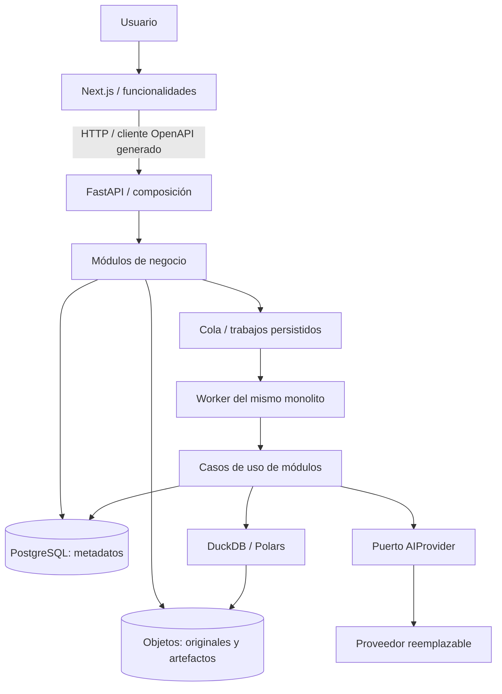

# Arquitectura inicial

Estado: base aceptada; contratos de backend propuestos, todavía sin implementación.

## Componentes

## Límites

Frontend: rutas y layouts en app, comportamiento por funcionalidad en features, primitivas en components/ui. Los datos de ejemplo están aislados en lib/demo y el estado de demostración en lib/providers. Las páginas no contienen credenciales ni SDK de IA. El shell actual se ejecuta en cliente porque es un prototipo local; al introducir sesiones, las verificaciones de sesión y composición apropiadas se trasladarán al servidor. No se duplicarán tipos HTTP: se generarán desde OpenAPI al conectar la API.

Backend: monolito modular con Proyectos, Datasets/Ingesta, Entendimiento, Calidad, Limpieza, Analítica (EDA y KPIs), Visualización, Informes (explicaciones y recomendaciones), Ejecuciones, Identidad y Auditoría. Las etapas no exigen correspondencia uno a uno con módulos.

Módulos complejos: domain → sin frameworks; application → dominio y puertos; infrastructure → implementaciones; presentation → HTTP y DTO. La composición inyecta implementaciones. Los módulos simples no requieren cuatro carpetas. Los módulos sólo consumen interfaces públicas de otros; no acceden a tablas ajenas ni importan adaptadores ajenos. El orquestador sólo coordina contratos.

Se verificarán límites con pruebas AST de importaciones y detección de ciclos, más revisión de interfaces públicas en CI. Frontend: restricciones de importación ESLint al crecer el número de funcionalidades. Ningún componente de infraestructura decide reglas de negocio.

## Entidades e invariantes

- Project: UUID, propietario/organización, nombre y permisos. Toda operación valida alcance.
- Dataset: UUID, project_id, identidad lógica, referencias de versiones.
- DatasetVersion: UUID, dataset_id, parent_version_id opcional, hash SHA-256 de contenido, URI interna, esquema, filas, origen y estado de publicación. Inmutable tras publicación; URI no accesible sin autorización. Metadatos de formato y esquema versionados.
- AnalysisPlan: UUID y revisión inmutable con operaciones permitidas, reglas, métricas, configuración y hash canónico. Cambiarlo crea revisión.
- AnalysisExecution: UUID, tenant/project, versión de datos, versión de plan, clave de idempotencia y huella del entorno. Estado, tiempos y errores.
- StageExecution: etapa, ejecución, intento, dependencias, estado, entradas y referencias de salida. Reintentos no sobrescriben intentos anteriores.
- AnalysisArtifact: UUID, ejecución, etapa, tipo y versión de esquema, hash, URI, parámetros. Sólo se publica después de validar integridad.
- EvidenceReference: artefacto, métrica/selector, filtros y versión. Una afirmación numérica debe coincidir con su evidencia dentro de tolerancias declaradas.
- Approval: actor, fecha, hash de propuesta, versión de entrada y alcance. Una edición invalida la aprobación anterior.
- AuditEvent: actor, acción, entidad, correlation_id y fecha UTC; sin contenido tabular sensible.

## Ejecución y determinismo

Etapas: ingesta → entendimiento → calidad → limpieza → exploración → análisis → visualización → explicación → recomendaciones. Se permitirán omisiones explícitas cuando una etapa no sea necesaria y las dependencias lo admitan. Reanudar exige conservar entradas equivalentes; cambiar versión o plan invalida descendientes.

Estados: pending, running, awaiting_approval, succeeded, failed, cancelled, skipped. Transiciones validadas por el caso de uso. Cancelación cooperativa, timeout y heartbeat del worker. Una transacción registra trabajo y outbox; despachador publica en cola. Entrega al menos una vez: idempotencia y publicación atómica lógica de artefactos, no promesas de exactamente una vez.

PostgreSQL conserva el estado; Redis no es la única fuente de verdad. Un worker procesa referencias a objetos, no datasets dentro del mensaje. Artefactos provisionales se publican tras validación y se recolectan si quedan huérfanos. El worker ejecuta los mismos casos de uso, no otra implementación de negocio.

Registrar versión/hash de dataset y plan, configuración normalizada, versión de motor y dependencias, zona horaria, semillas y artefactos. Orden estable con desempate; dinero en decimal con escala explícita; UTC para instantes y zona de negocio para agrupaciones; nulos no equivalen a cero; tolerancias para flotantes. Comparar resultados canónicos y documentar cambios entre versiones de motores. El fixture frontend utiliza euros enteros y orden determinista; no sustituye el motor productivo.

## IA

Puerto AIProvider y servicios específicos sólo cuando existan consumidores. Respuestas estructuradas Pydantic, prompts versionados, modelo/configuración, timeout, presupuesto y registro redactado. Enviar perfiles y agregados mínimos. Texto del dataset es contenido no confiable, nunca instrucciones. Propuestas usan operaciones de una lista permitida. No ejecutar Python/SQL arbitrario. Si se añade SQL: AST, SELECT permitido, catálogo acotado, permisos de lectura, aislamiento y límites. Validar cifras y referencias antes de mostrar conclusiones; ante evidencia insuficiente, indicarlo. El motor sigue operativo sin IA. Conservar respuestas, sin prometer regeneración idéntica.

## Datos, seguridad y operación

PostgreSQL: usuarios, permisos y metadatos. Objetos: originales, Parquet y artefactos. DuckDB/Polars: cómputo con límites por trabajo. Retención configurable por organización; eliminación autorizada en dos pasos con tratamiento de referencias, obligaciones de retención y recolección de objetos. Verificación de hashes y pruebas de restauración.

Identidad mediante proveedor OIDC a seleccionar antes del primer despliegue multiusuario; sesión segura y protección CSRF donde aplique. Backend verifica permisos por proyecto en cada recurso. Validar firma y tipo de archivo, límites de filas/columnas/tamaño, archivos comprimidos y fórmulas de hojas de cálculo. Conectores externos sólo lectura y secretos cifrados, restricciones de red y destino. Consultas parametrizadas, TLS, URLs de objetos de corta duración y logs sin datos sensibles.

Correlation_id enlaza HTTP, ejecución y trabajo. Logs JSON, duración, memoria, profundidad de cola, trabajos atascados, errores por módulo y costo/latencia de IA. Health y readiness separados. Alertas y runbooks antes de producción.

## Pruebas y estándares

Unitarias: invariantes y funciones puras; integración: repositorios/objetos/motores; contrato: OpenAPI y cliente; E2E: carga, aprobación e informe; datos de referencia para reproducibilidad; evaluaciones IA de estructura, evidencia e inyección. Probar duplicación de jobs, fallos entre objeto y transacción, cancelación y accesos cruzados.

Python snake_case, tipos explícitos y excepciones de dominio sin HTTP. TypeScript estricto, componentes PascalCase y hooks useX. Errores API estables con code y correlation_id. Commits convencionales y revisiones pequeñas; ADR ante cambios de límites. CI independiente por aplicación, migraciones revisadas, cliente regenerado y comprobación de drift de contrato. No introducir interfaces sin un consumidor concreto.
