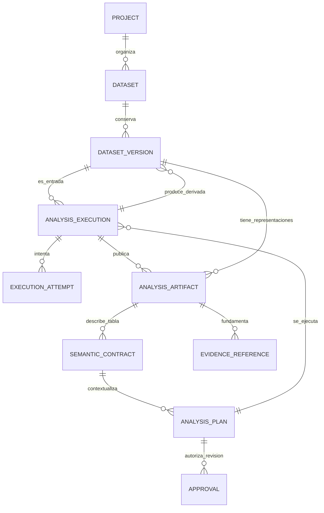

# Entidades e invariantes — contrato de diseño v1

## Convenciones

UUID minúsculos para identidades; revisión entera positiva; instantes UTC ISO-8601 terminados en `Z`; SHA-256 hexadecimal minúsculo. Los bytes de archivos usan hash físico. Revisiones de planes, contratos y efectos usan el hash canónico definido en [execution-contract.md](execution-contract.md). Decimales se serializan como cadenas, no como números de coma flotante.

`schema_version` identifica el formato del documento, `revision` su revisión de negocio, y `operation.version` la semántica de una operación: son conceptos diferentes.

## Relaciones



Las relaciones con planes y contratos siempre apuntan a revisiones concretas. Un artefacto de vista previa no es una versión publicada del dataset.

## 1. Dataset — propietario: datasets

Campos: `id`, `project_id`, `owner_id`, `name`, `revision`, `default_table_ref` opcional, `created_at`.

- Agrupa versiones, no contiene filas.
- `owner_id` pertenece al ámbito autorizado del proyecto; el cliente no lo asigna.
- Nombre y selección predeterminada son metadatos mutables con control optimista por `revision`.
- `default_table_ref` fija versión y representación, no sólo el número de versión. Cambiar el predeterminado no cambia planes históricos.
- La política de un dataset principal por proyecto sigue vigente en el MVP, sin convertirla en una restricción conceptual permanente.

## 2. DatasetVersion — propietario: datasets

Campos: `id`, `dataset_id`, `number`, `kind`, `content`, `original_filename`, `parent_table_ref`, `produced_by_execution_id`, `row_lineage_artifact_id`, `created_at`.

`content` es una referencia privada a un objeto: `object_id`, `sha256`, `byte_size`, `media_type`. Su traducción a ruta local o clave S3 pertenece al adaptador de almacenamiento y no aparece en DTO públicos.

| Tipo       | Contenido primario                        | Padre / ejecución productora                                   |
| ---------- | ----------------------------------------- | -------------------------------------------------------------- |
| `imported` | Bytes originales CSV                      | Sin padre; registro creado al aceptar la carga                 |
| `derived`  | Tabla materializada, inicialmente Parquet | Input tabular exacto, ejecución y artefacto de correspondencia |

- Una versión publicada no se edita. Cambiar datos crea otra versión; `(dataset_id, number)` es único.
- `number` es consecutivo según publicación/registro confirmado y se asigna con lock del dataset, no en el navegador.
- El hash del contenido identifica bytes, no equivalencia semántica entre formatos.
- El registro de una versión importada no garantiza que su extracción haya tenido éxito. El original puede existir con ejecución fallida.
- Una derivada sólo se publica cuando tabla, esquema y correspondencia están verificados. No se publica una versión parcialmente calculada.
- La importación inicial trata la extracción a texto nullable como representación; no sobrescribe el original.
- No hay campos de estado de ejecución en esta entidad. El `VersionResponse` vigente podrá seguir siendo una proyección compuesta durante la compatibilidad.

### Archivo y tabla son identidades distintas

El mismo CSV puede leerse con parámetros diferentes. Por eso un análisis tabular consume:

```text
version_id + version_content_sha256
representation_artifact_id + representation_sha256
```

El artefacto debe ser una tabla publicada de esa versión. No se permite resolver silenciosamente «el último Parquet» de una versión. La ingesta puede consumir sólo la versión fuente porque todavía no existe su tabla.

## 3. SemanticContract — propietario: understanding

Cada revisión es inmutable: `id` de revisión, `family_id`, `revision`, `previous_revision_id`, `content`, `content_sha256`, `created_by`, `created_at`.

El contenido fija:

- `table_ref`: representación exacta y sus hashes.
- `row_grain`: qué representa una fila, o estado desconocido explícito.
- Columnas con ID estable, ordinal, nombre original y tipo técnico tomado del esquema publicado.
- Tipo sugerido y rol semántico: desconocido, identificador, dimensión, medida o fecha de negocio.
- Unidad, moneda ISO cuando corresponda, formato de interpretación y política de nulos.
- Clave candidata/confirmada y su política de nulos.
- Estado de revisión (`pending`, `confirmed`, `rejected`), origen (`heuristic`, `ai`, `user`, `migration`) y actor.

Invariantes:

1. Los nombres, ordinales y tipos técnicos describen el artefacto; no se modifican para fingir una conversión.
2. Los IDs de columnas se asignan una vez al publicar el esquema. Transformaciones que mantienen la columna conservan su identidad; columnas nuevas necesitan una identidad explícita.
3. Una confirmación humana registra actor y origen `user`; una sugerencia de IA no se marca como confirmada automáticamente.
4. Una clave confirmada expresa una intención de negocio. Los duplicados existentes generan incidencias; no se borran por confirmar la clave.
5. Requisitos pendientes sólo bloquean operaciones que los necesitan. Perfilar una tabla no exige confirmar moneda ni granularidad.
6. Otra representación o versión requiere contrato compatible revisado explícitamente. No se trasladan confirmaciones por coincidencia de nombres.

## 4. AnalysisPlan — propietario: planning

Revisión inmutable con la misma envolvente de identidad/revisión/hash. `content` contiene objetivo opcional, input fijado, contrato semántico opcional, pasos ordenados y configuración de ejecución explícita.

- `id` identifica una revisión; `family_id` agrupa revisiones de un mismo plan. Un cambio de contenido crea otro `id` y aumenta `revision`.
- El input es una versión fuente para extracción o una tabla publicada para análisis/limpieza.
- Cada paso fija operación y versión, parámetros tipados e input (alias inicial o salida tabular de un paso anterior).
- Las operaciones pertenecen a un catálogo cerrado. No hay Python, SQL ni fórmulas arbitrarias ejecutables en v1.
- La validación y el estado de autorización son evaluaciones separadas del contenido inmutable. «Validado» no equivale a «aprobado».
- La política de aprobación se deriva del catálogo, no de una etiqueta enviada por el cliente.
- La selección de una nueva versión predeterminada no redirige un plan guardado. Reejecutar un plan histórico usa sus referencias originales y vuelve a comprobar acceso/disponibilidad/compatibilidad.

## 5. AnalysisExecution — propietario: executions

Campos: `id`, `project_id`, `requested_by`, `plan_ref`, `mode`, `state`, `idempotency_key`, `effective_config`, `reproducibility`, `approval_id`, `output_version_ids`, `created_at`, `finished_at`.

- `plan_ref` incluye ID de revisión, número y hash. Muchas ejecuciones pueden consumir la misma revisión y versión.
- `mode=preview` calcula efectos sin publicar una versión derivada ni cambiar el predeterminado.
- `mode=apply` ejecuta el plan; si transforma datos exige aprobación válida y publica como máximo una derivada en v1.
- La idempotencia se limita por `(project_id, operation_scope, key)` e incluye plan/revisión/hash, input, modo y autorización pertinente en la huella de solicitud. Misma clave con huella distinta da 409.
- Estado y timestamps son metadatos operativos, no parte del hash del plan.
- `effective_config` se fija antes de encolar; no se toma otra configuración del proceso worker silenciosamente.
- `reproducibility=legacy_partial` identifica historia incompleta. No se completa con versiones/configuraciones actuales inventadas.

## 6. ExecutionAttempt — propietario: executions

Campos: `id`, `execution_id`, `number`, `state`, `lease_until`, `fencing_token`, `environment`, `started_at`, `finished_at`, `error`.

- `(execution_id, number)` es único. No se sobrescribe el intento anterior al reintentar.
- Tokens/leases son privados, no credenciales expuestas en el frontend.
- Sólo el intento activo, con lease válido y token coincidente, puede confirmar resultados.
- El entorno registra build/código, Python, Polars, hash del lock de dependencias y de la configuración. Un worker incompatible no sustituye versiones de operaciones.
- En v1 el reintento repite el plan completo. No se promete reanudación por paso.
- Los errores públicos no contienen datos de las filas ni secretos; detalles técnicos redactados se relacionan por correlación.

## 7. AnalysisArtifact — propiedad coordinada

Executions controla publicación/estado; datasets controla vínculo a versiones y representaciones; cada módulo productor define el esquema del payload.

Campos: `id`, `project_id`, `execution_id`, `attempt_id`, `step_id`, `slot`, `kind`, `schema_version`, `version_id` opcional, `content`, esquema/conteo tabular cuando corresponde y `logical_content_sha256` opcional.

- Unicidad de salida publicada: `(execution_id, step_id, slot)`, no `(version_id, kind)`.
- Varias ejecuciones producen varios perfiles o diagnósticos sobre la misma tabla sin sobrescribir resultados.
- `kind` v1: `table`, `profile`, `quality`, `cleaning_preview`, `row_lineage`.
- Sólo un intento exitoso aporta el conjunto publicado. Objetos provisionales de intentos fallidos u obsoletos no son referencias consumibles.
- Un preview puede tener `version_id=null`; nunca se utiliza como tabla de entrada de otro análisis.
- Payload y metadatos deben concordar: número de filas, esquema, procedencia y hash. Validar JSON no sustituye esta comprobación.

## 8. Approval — propietario de la decisión: cleaning

Registro de concesión inmutable: `id`, `project_id`, `approved_by`, `plan_ref`, `input_ref`, `semantic_ref`, `preview_artifact_id`, `effect_sha256`, `effective_config_sha256`, `environment_sha256`, `granted_at`, `expires_at` opcional.

- Autoriza un efecto previsualizado sobre referencias exactas; no cualquier operación futura de un proyecto.
- Se verifica al encolar y antes de confirmar la publicación. Un permiso revocado, aprobación revocada o discrepancia impide publicar.
- Revocación como evento/registro aparte; no se borra la concesión ni el historial.
- `ApprovalRevocation`: ID, proyecto, ID de aprobación, actor, instante y motivo. Una revocación posterior no reescribe el hecho histórico de una ejecución ya confirmada; sí impide nuevas ejecuciones/publicaciones desde su vigencia.
- Reutilizar una aprobación para reejecutar el mismo plan/input/entorno requiere política explícita y vuelve a validar vigencia. La idempotencia de un reintento no implica autorización sobre otro input.
- Una versión nueva del proyecto no invalida por sí misma el contenido histórico. Lo que no está permitido es cambiar la entrada autorizada sin otra aprobación.

## 9. EvidenceReference — propietario: módulo consumidor

Campos: `id`, `project_id`, `artifact_id`, `artifact_sha256`, selector tipado, valor esperado/unidad cuando corresponda y `created_at`.

- Selector v1 de métrica: clave registrada y ruta conocida, no expresión o código libre. Selector de incidencia: regla e ID de incidencia. Selector de fila: ordinal y columna identificada.
- Se comprueba proyecto, tipo/esquema del artefacto y que la referencia exista. Las cifras deben coincidir con el payload calculado.
- La evidencia no se traslada al artefacto «más reciente». Un informe histórico conserva su evidencia original.
- Una explicación sin evidencia suficiente se etiqueta como hipótesis o no se presenta como hallazgo verificado.

## Correspondencia de filas

Identidad de fila fuente: `(version_id, representation_artifact_id, record_number)`; `record_number` es 1-based dentro de esa tabla, no línea física del CSV. Orden estable obligatorio.

Para trim/conversión/filtro/deduplicación inicial, cada fila de salida tiene exactamente una fila padre. Un artefacto `row_lineage` registra ordinal de salida → referencia de fila de entrada; las exclusiones se describen en el resumen de efectos y permiten comparar los conjuntos. No se añade una columna interna con nombre que pueda colisionar con columnas del usuario. Joins/agregaciones con múltiples padres quedan fuera de v1.
