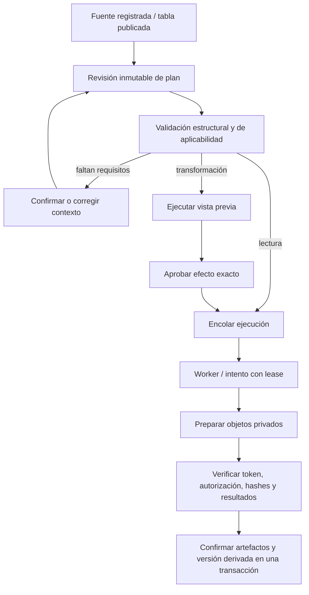

# Planes, ejecución y autorización

## 1. Flujo de control



El objetivo es opcional. Sin objetivo se ofrece un catálogo de exploraciones aplicables; no se inventa un KPI de negocio. La autorización de una transformación es independiente del origen humano/heurístico/IA de su propuesta.

## 2. Contenido del plan v1

Un input (`source`) y una lista secuencial de hasta 16 pasos con IDs únicos. Un paso consume el input o una salida tabular anterior. Los pasos de perfil/calidad producen diagnósticos, no tablas consumibles. Las referencias adelantadas, ciclos y operaciones desconocidas se rechazan.

El plan fija una política con: versión de catálogo, reglas, timeout, intentos máximos, lease, precisión/redondeo y conservación del orden. Todos los valores que afectan la ejecución son explícitos; el worker valida que su configuración de seguridad puede atenderlos. Si un límite del despliegue es más restrictivo, rechaza de forma explícita; no cambia el plan silenciosamente.

No se incluye un campo de confianza de IA como condición de ejecución. Un texto generado no es una autorización ni una fórmula ejecutable.

## 3. Catálogo objetivo inicial

| Operación / versión          | Input → salida  | Parámetros e invariantes                                                                                                          |
| ---------------------------- | --------------- | --------------------------------------------------------------------------------------------------------------------------------- |
| `ingestion.read_csv@1`       | fuente → tabla  | UTF-8-sig, separador efectivo fijo y solicitud original, parser estricto, vacíos→null, líneas vacías omitidas, límites explícitos |
| `understanding.profile@1`    | tabla → perfil  | precisión 50, HALF_EVEN, unicidad sin nulos, heurísticas de tipos versionadas                                                     |
| `quality.evaluate@1`         | tabla → calidad | conjunto exacto `csv-quality-v1`, Q-001/Q-002/Q-003 y fórmula `cell_completeness_v1`                                              |
| `cleaning.trim_whitespace@1` | tabla → tabla   | columnas por ID, bordes con caracteres `SP/TAB/CR/LF`, nulos preservados, resultado vacío→null explícito                          |
| `cleaning.filter_rows@1`     | tabla → tabla   | excluir registros que cumplen un predicado limitado: columna `is_null` o `is_whitespace_only`; conservar orden                    |
| `cleaning.deduplicate@1`     | tabla → tabla   | columnas de comparación explícitas, conservar primera aparición, política de claves nulas `reject` o `group_nulls`                |
| `cleaning.cast@1`            | tabla → tabla   | una columna, tipo y formato de catálogo, error→fallar el plan, sin exclusiones/valores imputados implícitos                       |

Los nombres son contratos objetivo, no operaciones ya implementadas. La ingesta actual se adaptará a los tres primeros. La limpieza se añadirá en Fase 6, operación por operación.

Conversión inicial: `integer_ascii` (sin separadores ni ceros iniciales ambiguos), `decimal_dot` (sin separador de miles, escala explícita 0..12 y HALF_EVEN), `iso_date` (YYYY-MM-DD válido), `boolean_lowercase` (true/false exactos). Pares formato/tipo incompatibles o desbordamientos se rechazan. Una columna confirmada como identificador no se convierte a medida numérica por inferencia. Otros formatos regionales requerirán otra entrada de catálogo revisada; no se elige entre fechas ambiguas.

Gramáticas completas: entero `[+-]?(0|[1-9][0-9]*)`; decimal `[+-]?(0|[1-9][0-9]*)(\.[0-9]+)?`, sin notación exponencial. No se recortan espacios automáticamente al convertir: se requiere un paso trim explícito si corresponde. Enteros dentro de int64 con signo; decimales de precisión máxima 38, escala declarada y cuantización HALF_EVEN, fallando si exceden la precisión. Fechas ISO de año 0001..9999 con calendario válido. Booleanos sólo las cadenas `true` y `false`. Salidas canónicas sin signo `+`, cero entero como `0`, decimal con su escala fija y cero sin signo negativo. El esquema de salida conserva esos parámetros de tipo. Los nulos se preservan, los errores abortan y el preview muestra toda alteración/ redondeo antes de autorizarla.

Trim puede aumentar nulos al normalizar una celda sólo de espacios: la vista previa lo debe mostrar; «mejor limpieza» no se equipara a mayor completitud.

## 4. Estados

### Plan y revisión

Contenido guardado e inmutable. La UI deriva: borrador, requisitos pendientes, válido, vista previa disponible, requiere aprobación, autorizado, rechazado o supersedido. La validación y las decisiones son registros separados; editar contenido crea revisión nueva. Un plan supersedido puede consultarse y solicitar una reejecución histórica explícita, volviendo a validar acceso, entorno y autorización. Nunca se reescribe su input al predeterminado actual.

### AnalysisExecution

```text
queued → running → succeeded
  │         ├── queued       (fallo transitorio con intentos disponibles)
  │         ├── failed       (entrada inválida / intentos agotados)
  └─────────┴── cancelled
```

`succeeded`, `failed` y `cancelled` son terminales. Reejecutar un trabajo terminal crea otra ejecución; reutilizar su clave idempotente devuelve el resultado de esa misma solicitud, no reinicia el registro.

No hay estado «esperando aprobación» con lease adquirido: la autorización es prerrequisito de encolado de `apply`. Una ejecución preview puede prepararse sin aprobar la transformación porque no publica una versión derivada ni cambia selecciones del proyecto.

### ExecutionAttempt

```text
running → succeeded | failed | expired | cancelled
```

Cada recuperación crea otro intento y token. El intento anterior conserva su historia. El agotamiento de intentos cambia el estado del padre a failed. En v1 la lease debe superar timeout más margen de publicación; 120/45 segundos son los valores vigentes de referencia. La transacción de confirmación comprueba lease/token nuevamente y debe tener timeout acotado.

## 5. Vista previa y aprobación

La vista previa usa el mismo ejecutor de operaciones que `apply` y datos completos dentro de los límites del MVP. El muestreo se limita a lo que se muestra; los conteos de impacto no se estiman a partir de muestras.

Manifiesto de efecto:

- Plan/revisión/hash, tabla de entrada y contrato semántico.
- Hash de configuración efectiva y huella del entorno.
- Esquema de salida ordenado y hash lógico del contenido de salida.
- Conteos exactos: filas de entrada/salida/excluidas, filas modificadas, celdas modificadas, nulos creados y errores de conversión.
- Correspondencia de filas y advertencias aplicables.

`effect_sha256` se calcula sobre ese manifiesto canónico, sin IDs aleatorios de archivos temporales ni timestamps. `apply` recalcula y compara el efecto antes de publicar. Una diferencia produce fallo de precondición y exige revisión; no se publica una versión «parecida».

La aprobación fija plan, input, semántica, preview, efecto, configuración y entorno. Se comprueban dueño/permisos y revocación al encolar y al confirmar. Aprobar «la limpieza del proyecto» sin estas referencias no es válido. V1 exige una única salida tabular final para una limpieza; perfil y calidad son artefactos asociados.

Una nueva versión o contrato predeterminado no invalida un registro histórico por sí sola. Cambiar el input/contrato de una ejecución propuesta sí cambia la huella y necesita otra autorización. El aprobador debe poder inspeccionar que está usando una entrada histórica.

## 6. Hash canónico v1

Dominio explícito para evitar confundir documentos:

```text
sha256( UTF8("dataflow:" + domain + ":v1\n") || UTF8(canonical_json(payload)) )
```

`domain` es `plan`, `semantic`, `config`, `environment`, `effect`, `table` o `row_lineage`. Para planes/contratos se hashea exactamente `content`, incluyendo referencias y orden de pasos; se excluyen ID de revisión/familia, actor y fecha de creación. No se excluye el objetivo si está dentro de content.

Reglas: claves de objetos ASCII con patrón `[a-z][a-z0-9_]*`, ordenadas lexicográficamente; sin espacios de formato; arrays densos conservan orden; UTF-8 sin normalización Unicode; cadenas conservadas literalmente y sin surrogates aislados; enteros seguros entre -(2^53-1) y +(2^53-1); prohibidos valores fraccionarios numéricos, -0, NaN e infinitos. Decimales como cadenas con representación explícita. Ausente y null no son equivalentes: schemas declaran los campos obligatorios y null donde procede. Los receptores deben rechazar claves JSON duplicadas antes de normalizar documentos sometidos a hash. El algoritmo es una especificación restringida propia, no una afirmación de implementación completa de RFC 8785.

Para `table`: payload `{columns, rows}`. Esquema de columnas y filas en orden; valores de texto exactos, null distinto de vacío/espacios, enteros/decimales tipados como cadenas canónicas y fechas ISO, booleanos JSON. Los metadatos de ejecución y posiciones de almacenamiento quedan fuera. Cambiar un tipo o el orden sí cambia el hash lógico. El hash físico del Parquet se conserva además y puede cambiar entre entornos aunque la tabla lógica sea equivalente.

La representación de números convertidos debe quedar fijada por el formato/escala de la operación. Las operaciones v1 no reordenan: deduplicación conserva la primera aparición de la tabla fijada. No se presupone orden de consultas SQL sin ORDER BY.

En el manifiesto, una celda modificada cambia de valor o cambia de tipo conservando un valor no nulo. Una fila modificada tiene al menos una celda modificada. `created_nulls` cuenta valores no nulos convertidos a null; filas excluidas se cuentan aparte. Esto evita que distintas implementaciones presenten impactos diferentes para el mismo efecto.

## 7. Configuración y entorno

Snapshot de plan: límites de filas/columnas/campo, parser, separador solicitado/efectivo, nulos, reglas, precisión/redondeo, orden, timeout, lease e intentos. Resolver `auto` es una operación determinista identificada; antes de sellar el plan ejecutable se conserva el separador resuelto. Una carga histórica sin esa información no se completa por suposición.

Snapshot por intento: build/código verificable, versión Python/Polars, hash del lock, plataforma y hash de configuración. Registrar también digest de imagen cuando exista. Si el entorno requerido no está disponible, se solicita una ejecución nueva con condiciones explícitas; no se promete reproducir un entorno antiguo descargándolo automáticamente.

Para una aprobación nueva, preview y apply deben usar la misma huella de entorno admitida. Migraciones históricas con datos incompletos se marcan `legacy_partial`; las ejecuciones nuevas requieren procedencia completa. Cambiar un modelo de IA no cambia un plan ya guardado. Se conservan por separado propuestas de IA y sus parámetros, nunca se vuelve a generar una propuesta para reproducir un cálculo.

## 8. Rechazos de contrato previstos

`INPUT_MISMATCH`, `PLAN_HASH_MISMATCH`, `SEMANTIC_REQUIREMENT_MISSING`, `UNSUPPORTED_OPERATION`, `INVALID_STEP_REFERENCE`, `APPROVAL_REQUIRED`, `APPROVAL_SCOPE_MISMATCH`, `APPROVAL_REVOKED`, `PREVIEW_EFFECT_MISMATCH`, `ENVIRONMENT_MISMATCH`, `REVISION_CONFLICT`, `IDEMPOTENCY_CONFLICT`. Son códigos objetivo; su mapeo HTTP se implementará en Fase 2/6 y todavía no forma parte del OpenAPI efectivo.
