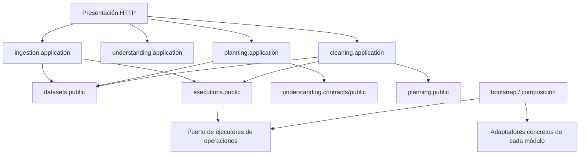

# Responsabilidades y dependencias objetivo

## Propiedad

| Módulo        | Posee                                                            | Contrato público previsto                                                             |
| ------------- | ---------------------------------------------------------------- | ------------------------------------------------------------------------------------- |
| identity      | Usuario y sesiones                                               | Identidad autenticada                                                                 |
| projects      | Proyecto y permisos                                              | `require_access(actor, project, action)`                                              |
| datasets      | Dataset, versiones, identidad tabular y referencias de contenido | Registrar fuente, resolver tabla exacta, reservar/publicar derivada, consultar linaje |
| ingestion     | Recepción y extracción por formato                               | Preparar plan de lectura y ejecutar reader registrado                                 |
| understanding | Perfil y revisiones semánticas                                   | Perfilar, revisar semántica, resolver requisitos                                      |
| quality       | Catálogo de reglas y esquema de diagnóstico                      | Evaluar reglas y localizar incidencias                                                |
| planning      | Revisiones de plan y validación de aplicabilidad                 | Crear revisión, validar, resolver operaciones autorizadas                             |
| cleaning      | Propuestas/efectos, aprobación y operaciones de transformación   | Previsualizar, aprobar/revocar y ejecutar operaciones permitidas                      |
| executions    | Ejecuciones, intentos y registro/publicación de artefactos       | Encolar, adquirir, renovar/finalizar, cancelar, consultar                             |
| audit         | Eventos con referencias a decisiones/resultados                  | Añadir evento dentro de la transacción de la operación                                |

La propiedad del payload de un artefacto corresponde al productor. Su registro/visibilidad se controla desde executions y las referencias tabulares desde datasets, sin duplicar bytes ni crear dos fuentes de verdad para el estado de publicación.

## Dependencias permitidas

El registro de operaciones usa puertos y descriptores de capacidades (input/output, versión, parámetros, requisitos, impacto). `executions` no importa implementaciones de cleaning/quality/ingestion: bootstrap las registra. Planning valida descriptores sin ejecutar infraestructura de otros módulos. Esto evita un ciclo `cleaning → executions → cleaning` en imports.

El futuro adaptador LLM vive en `integrations/ai`; cada funcionalidad conserva prompts, schemas y validación de negocio. El proveedor no calcula KPIs ni obtiene permisos por declarar una herramienta en texto.

## Límites internos

- Domain: reglas puras, invariantes y errores sin FastAPI, ORM, Polars ni proveedor IA.
- Application: casos de uso y puertos; no decide implementaciones de almacenamiento, cola o motor.
- Infrastructure: SQL, objetos, Polars y adaptadores. Puede hacer comparación atómica de revisión/token requerida por un contrato, pero no inventar políticas de aprobación o tratamiento de datos.
- Presentation: parseo, sesión, DTO y códigos HTTP; no coordina transacciones complejas ni ejecuta transforms.
- `public.py`/`contracts.py`: único acceso permitido entre módulos; sin exponer Session, entidades ORM ni funciones internas al dominio consumidor.
- Bootstrap: conoce implementaciones, inyecta repositorios y registra operaciones. Los modelos SQL se registran explícitamente tanto en API como en worker.

## Transacciones entre módulos

La separación de carpetas no debe dividir una operación atómica en varios commits. Un puerto UnitOfWork/composición transaccional controlará estos límites:

1. Registrar fuente/versión importada + plan de lectura + ejecución en cola + auditoría.
2. Adquirir un trabajo + cerrar intento vencido + abrir nuevo intento/token + auditoría.
3. Confirmar intento + artefactos + derivada/linaje + actualización predeterminada autorizada + auditoría.
4. Conceder/revocar una aprobación y su evento.

Los repositorios participantes hacen flush y aportan escrituras; el caso de uso coordinador/composición confirma una vez. Los commits locales actuales se retirarán sólo dentro del recorrido migrado y con pruebas de rollback. El UnitOfWork no será un repositorio genérico ni un servicio de reglas universal.

Los objetos se preparan antes del commit y quedan invisibles hasta publicar sus referencias. Un fallo de transacción no autoriza a borrar inmediatamente un objeto de commit incierto; recuperación/recolección conserva los criterios del ADR-010.

## Frontend

Separación gradual dentro de features: `ingestion` para carga, `datasets` para selector/original/tabla/linaje, `understanding` para revisión semántica, `planning` para objetivo y plan, `cleaning` para preview/aprobación y `executions` para estados. `workspace` compone estos bloques. Los componentes UI base permanecen compartidos y los DTO HTTP se generan desde OpenAPI.

Las cachés de diagnóstico/preview se identificarán por artefacto/ejecución, no sólo por versión. La proyección legacy mantiene sus claves mientras siga devolviendo el mismo diagnóstico baseline. No se debe reutilizar una respuesta de otro plan por compartir version_id.

## Verificación de límites en Fase 2

Extender el análisis AST existente a búsqueda recursiva y a ambos tipos de importación, comprobar ciclos y excepciones explícitas de bootstrap. Añadir pruebas de consumo de interfaces públicas, rollback entre módulos, compatibilidad OpenAPI y migración con archivos reales de referencia. El chequeo de diseño de Fase 1 no sustituye estas pruebas de implementación.
