# DataFlow AI — Technical Design & Development Report (TDDR)

> Análisis de datos completamente automático, determinista y trazable sobre archivos y bases de datos
> propios, con un modelo de lenguaje que explica pero nunca calcula.

---

## Sección 0 — Portada y metadatos del proyecto

| Campo                  | Descripción                                                                                                                                                                                                                                                                               |
| ---------------------- | ----------------------------------------------------------------------------------------------------------------------------------------------------------------------------------------------------------------------------------------------------------------------------------------- |
| Título                 | DataFlow AI: plataforma web de análisis de datos automático, determinista y trazable                                                                                                                                                                                                      |
| Autores                | Alexander Sarmiento Montoya, Jose Donayre Alvarez                                                                                                                                                                                                                                         |
| Curso                  | Taller Integrador 1                                                                                                                                                                                                                                                                       |
| Docente                | Walter Cueva                                                                                                                                                                                                                                                                              |
| Universidad            | Universidad Privada Antenor Orrego (UPAO)                                                                                                                                                                                                                                                 |
| Fecha                  | 20 de noviembre de 2026                                                                                                                                                                                                                                                                   |
| Versión evaluada       | `main` en `64a3e45` (API 0.42.0, Fases 1 a 33 y despliegue)                                                                                                                                                                                                                               |
| Tipo de solución       | **Híbrida**: aplicación web (Next.js + FastAPI) con motor analítico determinista (Python/Polars, estadística) e **IA generativa** acotada (LLM Claude de Anthropic sólo para explicar y proponer)                                                                                         |
| Dominio de aplicación  | Analítica de negocio para organizaciones sin equipo de ciencia de datos (pymes, áreas académicas y administrativas): ventas, atención al cliente, rendimiento académico, etc.                                                                                                             |
| Repositorio del código | GitHub (privado): <https://github.com/Alexander20L/dataflow_ia>                                                                                                                                                                                                                           |
| Dataset                | No hay un dataset único: el sistema analiza los datos que sube cada usuario. Para la evaluación se usan los conjuntos de ejemplo del repositorio (`examples/`) y conjuntos sintéticos reproducibles generados con semilla fija (`docs/tddr/bench/`). Ver [Anexo E](anexos/E-datasets.md). |

---

## Sección 1 — Problema y motivación técnica

### 1.1 Descripción del problema real

**Contexto.** Muchas organizaciones guardan sus datos operativos en hojas de cálculo, archivos CSV
exportados de sus sistemas o bases de datos relacionales pequeñas (ventas, pedidos, reclamos, notas,
asistencia). Convertir esos datos en conclusiones fiables exige una cadena de pasos especializados:
leer formatos heterogéneos, revisar la calidad, limpiar, relacionar tablas, elegir análisis, aplicar
pruebas estadísticas, construir gráficos y redactar un informe. Sin un analista de datos, esa cadena no
se completa o se hace de forma manual y poco reproducible.

**Evidencia cuantitativa del problema.**

- _Los datos reales no vienen listos para analizar._ En hojas de cálculo y foros reales, más del 30 % de
  las tablas no tienen forma relacional y requieren reestructuración antes de cualquier análisis [33].
  Cargar un CSV ya es un problema: el estudio Pollock evaluó 16 sistemas de carga frente a miles de CSV
  públicos con dialectos no estándar y documentó fallos sistemáticos [32].
- _Las herramientas de calidad de datos no resuelven el problema de extremo a extremo._ Una revisión
  sistemática identificó 667 herramientas de calidad de datos y analizó 13 en detalle; las métricas de
  calidad aceptadas en investigación apenas están implementadas en ellas [28].
- _Explorar sin control estadístico produce conclusiones falsas._ En un experimento con datos sintéticos de
  verdad conocida, **más del 60 % de los hallazgos reportados por usuarios de herramientas de
  visualización eran falsos** por el problema de las comparaciones múltiples [9].
- _Los LLM no son fiables calculando sobre datos._ En el benchmark BIRD (95 bases de datos, 37 dominios),
  GPT-4 obtuvo un **54,89 % de exactitud de ejecución frente al 92,96 % humano** [38]; en verificación de
  afirmaciones numéricas reales, la mejor línea base alcanza **58,32 de macro-F1** [45]. Los analistas que
  revisan análisis generados por IA pueden llegar a conclusiones incorrectas a partir de respuestas
  «aparentemente correctas» (estudio con 22 analistas) [43].
- _La automatización actual sigue requiriendo intervención._ La revisión de AutoML de Karmaker et al.
  concluye que el proceso «todavía requiere intervención humana» en pasos vitales como entender los
  atributos y definir el problema [23].

**¿Por qué las soluciones actuales son insuficientes?**

1. Las herramientas de EDA y descubrimiento de _insights_ (Lux, DataPrep.EDA, MetaInsight,
   QuickInsights) suponen un usuario que programa o explora, trabajan sobre una tabla y no controlan las
   comparaciones múltiples [11], [15]–[17].
2. Los asistentes basados en LLM (Chat2VIS, LIDA, Data Formulator, texto a SQL) dejan que el modelo genere
   el código o la transformación que calcula las cifras, con el riesgo de alucinación documentado
   [35], [36], [38], [39], [40].
3. Las soluciones de relaciones entre tablas y _schema matching_ resuelven el emparejamiento, pero no el
   análisis posterior ni la explicación [19], [29], [34].
4. Las herramientas de BI comerciales requieren modelar los datos, elegir gráficos y redactar informes a
   mano.

### 1.2 Brecha tecnológica identificada

No existe, en los trabajos revisados (ver §2.3), una solución que combine a la vez: (a) automatización de
extremo a extremo sin formularios ni aprobaciones; (b) varias tablas relacionadas o un esquema de base de
datos analizados juntos; (c) cifras calculadas exclusivamente por un motor determinista y trazables hasta
su evidencia, con un LLM que sólo explica; (d) pruebas estadísticas con corrección por comparaciones
múltiples; y (e) linaje inmutable de cada transformación.

Se necesita una solución computacional porque cada uno de esos requisitos —conteos exactos sobre todo el
dataset, pruebas de significancia, control de la tasa de falsos descubrimientos, hashes canónicos de cada
efecto— es costoso y propenso a errores si se hace a mano, y porque delegarlo en un LLM no es fiable [38],
[45], [50].

### 1.3 Pregunta de investigación técnica

> **¿En qué medida una arquitectura que separa un motor analítico determinista (cálculo, reglas
> versionadas y pruebas estadísticas) de un modelo de lenguaje que sólo explica y propone permite obtener,
> sin intervención del usuario, un análisis correcto, trazable y en tiempo aceptable a partir de archivos
> o tablas relacionadas en el contexto del análisis de datos de negocio de organizaciones sin analistas?**

### 1.4 Objetivo general y objetivos específicos

**Objetivo general.** Desarrollar una plataforma web que, a partir de un archivo, varios archivos
relacionados o un esquema de base de datos, lea, evalúe, limpie, comprenda, investigue, publique un
dashboard y redacte un informe de forma automática, con cifras calculadas por un motor determinista y
explicadas por IA generativa.

| ID  | Objetivo específico (medible)                                                                                                         | Indicador y meta                                                                                                                              | Sección         |
| --- | ------------------------------------------------------------------------------------------------------------------------------------- | --------------------------------------------------------------------------------------------------------------------------------------------- | --------------- |
| OE1 | Diseñar una arquitectura modular que aísle el cálculo determinista de la IA y lo verifique automáticamente                            | 100 % de las reglas de módulos comprobadas por pruebas AST; 0 cifras producidas por el LLM                                                    | §3, §5.4.4      |
| OE2 | Implementar el recorrido automático completo (lectura → informe) para CSV, Excel, archivos relacionados y bases PostgreSQL/SQL Server | Recorrido completo sin etapas fallidas en los conjuntos de prueba                                                                             | §4, §5.4.2      |
| OE3 | Detectar relaciones entre tablas sin falsos positivos                                                                                 | Precisión ≥ 0,95 en el benchmark de esquemas con verdad de referencia, superior a las líneas base con p < 0,05                                | §5.4.1          |
| OE4 | Garantizar tiempos de respuesta aceptables                                                                                            | p90 de las lecturas de la API < 500 ms; recorrido completo de un CSV de 10.000 filas < 5 min en un PC de escritorio                           | §5.4.2–5.4.3    |
| OE5 | Asegurar la calidad del software y su reproducibilidad                                                                                | Batería completa (pruebas unitarias, de integración, de arquitectura, E2E y análisis estático) en verde; instalación reproducible documentada | §5.4.4, Anexo D |

### 1.5 Alcance y limitaciones declaradas

**Incluye:** carga de CSV (UTF-8 o Windows-1252, separador detectado, valores regionales), Excel `.xlsx` (sin
elegir hoja), PDF con tablas, de 2 a 5 archivos relacionados y conexión a PostgreSQL y SQL Server (copia
de un solo uso, sólo lectura); inspección y diccionario de datos; limpieza segura; comprensión del negocio
(escalas, columnas calculadas, objetivo); investigación con pruebas estadísticas; dashboard con filtros;
informe PDF; explicación por IA; despliegue en un servidor Linux con contenedores.

**Excluye explícitamente:** modelos predictivos (regresión, clasificación, pronóstico), conversaciones
libres con la IA, edición manual de los datos, uniones de muchos a muchos o por claves compuestas,
fuentes en la nube (APIs, Google Sheets) y análisis en tiempo real.

**Restricciones:**

- _Datos:_ 5 MB por archivo, 100.000 filas y 128 columnas por tabla; 5 archivos relacionados (10 MB) o
  las tablas de un esquema de base de datos dentro de los límites de copia.
- _Hardware:_ desarrollo y evaluación en un PC de escritorio (Intel Core i5-9400F, 6 núcleos, 16 GB de RAM,
  Windows 10); producción en un único servidor Linux.
- _IA:_ depende de un proveedor externo (Anthropic) con presupuesto diario por usuario y mensual por
  proyecto; sin clave, el sistema funciona sin explicaciones (salvo que se exija IA).
- _Tiempo y dominio:_ proyecto académico de un semestre con dos desarrolladores; sin acceso a usuarios
  finales reales para una evaluación de usabilidad (ver §6.3).

### 1.6 Contribución técnica principal

1. **Arquitectura «la IA explica, el motor calcula» verificable**: el LLM sólo puede citar cifras mediante
   marcadores `{{evidence:id}}` que Python resuelve contra evidencias calculadas por el motor; todo
   número escrito libremente por el modelo se sustituye por una marca visible («[cifra no verificada]») y
   una referencia inválida descarta la respuesta completa. Las reglas de dependencia entre módulos se
   verifican con pruebas sobre el árbol sintáctico (AST) en cada ejecución de la batería.
2. **Regla `relations-v1` para modelar varias tablas sin intervención**: combina afinidad de nombres,
   contención total de valores y desambiguación, y genera vistas de hechos y una vista general por entidad
   con métricas exactas, de modo que todo el recorrido automático se aplica también al conjunto. En el
   benchmark de 200 esquemas alcanza precisión 1,000 frente a 0,522 y 0,195 de las líneas base (§5.4.1).
3. **Investigación estadística automática con control de falsos descubrimientos**: pruebas chi² y
   Kruskal-Wallis implementadas en Python puro, magnitud mínima por grupo y corrección de
   Benjamini-Hochberg antes de publicar hallazgos.
4. **Trazabilidad completa**: original y versiones inmutables, linaje y efecto exacto de cada
   transformación registrado con un hash canónico (`effect_sha256`), operaciones y reglas versionadas.
5. **Aplicación en un dominio poco explorado**: analítica de negocio automática para organizaciones sin
   analistas, con datos regionales (separadores, decimales y fechas en formato local) y en español.

---

## Sección 2 — Revisión de literatura técnica

### 2.1 Marco conceptual técnico

El **análisis exploratorio de datos (EDA)** es la etapa en la que se resumen e inspeccionan los datos para
encontrar patrones antes de modelar; las bibliotecas actuales lo automatizan parcialmente orientándolo a
tareas [16]. El **descubrimiento automático de _insights_** busca y puntúa patrones interesantes en datos
multidimensionales sin que el usuario los formule [11], [17], y la **recomendación de visualizaciones**
elige automáticamente los gráficos adecuados para una tabla [12], [15], [26]. **AutoML** automatiza etapas
de la canalización de aprendizaje automático y se clasifica por niveles de autonomía [22], [23]; la
**ciencia de datos automática** extiende esa idea a todo el proceso analítico [24].

La **calidad de datos** se mide por dimensiones y métricas mediante perfilado y monitorización [28], y la
**validación de datos** la comprueba con restricciones declarativas o patrones inferidos, a modo de
«pruebas unitarias» de los datos [7], [18]; previamente, la **detección del dialecto** de un CSV
(delimitador, comillas) decide cómo leer el archivo [14], [32].

Una **clave foránea** es una columna cuyos valores están contenidos en la clave primaria de otra tabla y
puede detectarse a partir de los datos [13]; el _**schema matching**_ establece correspondencias entre
columnas de esquemas distintos [19], [48]. La **procedencia o linaje** registra de dónde viene cada dato y
cómo se transformó [6].

En los LLM, la **alucinación** es la generación de contenido no respaldado por la fuente [39], [50], y el
**texto a SQL** traduce preguntas en lenguaje natural a consultas ejecutables [49]. El **problema de las
comparaciones múltiples** aumenta los falsos descubrimientos al examinar muchas hipótesis, también en la
exploración visual [8], [9]; la **tasa de falsos descubrimientos (FDR)** y su control por el procedimiento
de Benjamini-Hochberg lo acotan [1]. La prueba **chi²** contrasta frecuencias observadas y esperadas [3] y
la prueba de **Kruskal-Wallis** compara distribuciones de varios grupos mediante rangos [2]. La
**visualización narrativa** organiza hechos de datos en una historia, cada vez con más automatización [20],
[47]. Por último, la calidad del producto software se evalúa con el modelo de **ISO/IEC 25010** [5] y la
usabilidad percibida con la escala **SUS** [4].

### 2.2 Estado del arte de soluciones similares

35 trabajos de 2021–2026. Para 28 de ellos (los del Anexo H §1) la métrica y la limitación se tomaron
sólo del resumen publicado; de [21], [22], [24], [25], [35], [49] y [50] sólo se verificó la referencia
(DOI) y se describe su tipo, sin cifras; «(obs.)» marca una observación propia frente al alcance de DataFlow AI, no declarada por los
autores. La verificación de cada referencia está en
[anexos/H-verificacion-referencias.md](anexos/H-verificacion-referencias.md).

| Ref                      | Año  | Tipo de solución                                  | Técnica/Tecnología                                                  | Dataset/Contexto                                     | Métrica principal                                            | Limitación reportada                                             |
| ------------------------ | ---- | ------------------------------------------------- | ------------------------------------------------------------------- | ---------------------------------------------------- | ------------------------------------------------------------ | ---------------------------------------------------------------- |
| [15] Lux                 | 2021 | EDA automático / recomendación de visualizaciones | Recomendación «siempre activa» al imprimir un dataframe de pandas   | Cuadernos Jupyter; datasets UCI                      | Sobrecarga ≤ 2 s sobre pandas en > 98 % de los datasets UCI  | (obs.) Requiere programar en un cuaderno; una sola tabla         |
| [16] DataPrep.EDA        | 2021 | EDA automático orientado a tareas                 | API declarativa en Python sobre Dask                                | Comparación con Pandas-profiling                     | Velocidad y experiencia de usuario (sin cifra en el resumen) | (obs.) El usuario especifica la tarea                            |
| [17] MetaInsight         | 2021 | Descubrimiento automático de _insights_           | Patrones homogéneos, comunalidades y excepciones, ranking           | Datos multidimensionales reales; estudios de usuario | Efectividad y eficiencia (sin cifra en el resumen)           | (obs.) Sin control de comparaciones múltiples declarado          |
| [18] Auto-Validate       | 2021 | Validación automática de datos                    | Patrones de dominio inferidos de un _data lake_                     | Datos de producción (Azure Purview)                  | Falsos positivos frente a problemas detectados (sin cifra)   | Enfoques previos con muchos falsos positivos en texto            |
| [19] Valentine           | 2021 | Banco de pruebas de _schema matching_             | Métodos clásicos reimplementados; datasets con verdad de referencia | Descubrimiento de datasets; 4 escenarios             | Efectividad y eficiencia (sin cifra)                         | Falta de verdad de referencia en la literatura previa            |
| [20] Calliope            | 2021 | Historias de datos automáticas                    | Búsqueda en árbol Monte Carlo; teoría de la información             | Hojas de cálculo; 2 experimentos; 10 expertos        | Eficiencia de generación (sin cifra)                         | (obs.) Requiere editor de revisión; sin pruebas de significancia |
| [21] NL4DV               | 2021 | Lenguaje natural a especificación analítica       | Kit de herramientas de PLN para consultas de visualización          | Consultas en lenguaje natural sobre tablas           | Sin cifra en el resumen                                      | (obs.) Guiado por la pregunta del usuario                        |
| [22] He et al.           | 2021 | Revisión de AutoML                                | Taxonomía de la canalización de AutoML                              | Literatura de AutoML                                 | Sin métrica (revisión)                                       | (obs.) Centrado en modelos predictivos                           |
| [23] Karmaker et al.     | 2022 | Revisión de AutoML                                | 7 niveles de autonomía                                              | Canalización de ML de extremo a extremo              | Sin métrica (revisión)                                       | «Todavía requiere intervención humana» en pasos vitales          |
| [24] De Bie et al.       | 2022 | Ciencia de datos automática                       | Marco conceptual de automatización del proceso analítico            | Proceso completo de ciencia de datos                 | Sin métrica (posición)                                       | (obs.) Sin implementación evaluada                               |
| [25] AI4VIS              | 2022 | Revisión de IA para visualización                 | Taxonomía de enfoques de IA para visualización                      | Literatura de visualización                          | Sin métrica (revisión)                                       | (obs.) No aborda cifras trazables                                |
| [26] KG4Vis              | 2022 | Recomendación de visualizaciones explicable       | Grafo de conocimiento + embeddings TransE                           | Pares dataset–visualización                          | Comparaciones cuantitativas (sin cifra)                      | Reglas manuales tediosas; ML como caja negra                     |
| [27] ncNet               | 2022 | NL2VIS                                            | Transformer secuencia a secuencia                                   | nvBench; estudio de usuario                          | Precisión en nvBench (sin cifra)                             | (obs.) Depende de la consulta del usuario                        |
| [28] Ehrlinger y Wöß     | 2022 | Revisión de herramientas de calidad               | Búsqueda sistemática y catálogo de requisitos                       | 667 herramientas, 13 analizadas                      | 13 herramientas evaluadas                                    | Métricas de investigación apenas implementadas                   |
| [29] Auto-BI             | 2023 | Modelos BI automáticos (varias tablas)            | Predicción local de joins + grafo global (k-MCA)                    | > 100K modelos BI reales; 4 benchmarks TPC           | F1 > 0,9; < 1 s con ~100 tablas                              | k-MCA intratable en general                                      |
| [30] DeepJoin            | 2023 | Descubrimiento de tablas combinables              | Modelo de lenguaje preentrenado + ANN                               | _Data lakes_ reales                                  | Hasta 2 órdenes de magnitud más rápido (GPU)                 | Atributos de texto de cardinalidad pequeña                       |
| [31] Starmie             | 2023 | Descubrimiento de datasets                        | Aprendizaje contrastivo de columnas; HNSW                           | Benchmarks de _table union search_                   | +6,8 en MAP y recall; 3.000× frente a escaneo lineal         | (obs.) Unión de tablas, no clave–clave foránea                   |
| [32] Pollock             | 2023 | Benchmark de carga de CSV                         | Contaminación sistemática de dialectos                              | Miles de CSV; 16 sistemas                            | Robustez de carga de 16 sistemas                             | El CSV flexible obliga a preparación engorrosa                   |
| [33] Auto-Tables         | 2023 | Reestructuración automática de tablas             | Síntesis de transformaciones sin ejemplos                           | 244 casos reales                                     | > 70 % de casos resueltos                                    | (obs.) ~30 % sin resolver                                        |
| [34] LSM                 | 2023 | _Schema matching_ con modelos de lenguaje         | Preentrenado + aprendizaje activo                                   | Esquemas reales de clientes                          | Hasta 81 % de ahorro de etiquetado                           | Necesita etiquetado del usuario                                  |
| [35] LIDA                | 2023 | Visualizaciones e infografías con LLM             | Canalización de varias etapas con LLM                               | Datasets diversos                                    | Sin cifra en el resumen                                      | (obs.) El LLM genera el código de visualización                  |
| [36] Chat2VIS            | 2023 | Visualización desde lenguaje natural con LLM      | Prompts sobre GPT-3, Codex y ChatGPT                                | Estudios de caso                                     | Comparación cualitativa                                      | Ambigüedad del lenguaje; (obs.) el LLM calcula                   |
| [37] ¿GPT-4 analista?    | 2023 | LLM como analista de extremo a extremo            | Prompts; comparación con profesionales                              | Bases de varios dominios                             | Rendimiento «comparable» (sin cifra)                         | Faltan estudios para concluir sustitución                        |
| [38] BIRD                | 2023 | Benchmark de texto a SQL                          | 12.751 pares, 95 bases (33,4 GB)                                    | Bases con contenido sucio                            | GPT-4: 54,89 % vs. 92,96 % humano                            | Hay que entender los valores, no sólo la semántica               |
| [40] Data Formulator     | 2023 | Autoría de visualizaciones con agente de IA       | _Concept binding_; el agente transforma                             | Estudio con 10 participantes                         | Sin cifra de rendimiento                                     | (obs.) La IA transforma; el autor inspecciona                    |
| [41] DAIL-SQL            | 2024 | Texto a SQL con LLM                               | Selección y organización de ejemplos                                | Spider                                               | 86,6 % de exactitud de ejecución                             | Coste en tokens                                                  |
| [42] Table-GPT           | 2024 | LLM ajustado para tablas                          | _Table fine-tuning_                                                 | Limpieza, perfilado, QA de tablas                    | Supera a GPT-3.5 (sin cifra)                                 | LLM subóptimos en tablas                                         |
| [43] Gu et al.           | 2024 | Verificación humana de análisis con IA            | Sonda de diseño                                                     | 22 analistas                                         | Estudio cualitativo (n = 22)                                 | Respuestas aparentemente correctas llevan a errores              |
| [44] Kazemitabaar et al. | 2024 | Dirección y verificación de análisis con LLM      | Descomposición por pasos/fases                                      | n = 15 y n = 18                                      | Mayor control percibido (significativo)                      | Verificar resultados de IA es difícil                            |
| [45] QuanTemp            | 2024 | Verificación de afirmaciones numéricas            | Descomposición; NLI numérico                                        | Afirmaciones reales multidominio                     | Macro-F1 58,32 (mejor línea base)                            | Afirmaciones numéricas complejas                                 |
| [46] DataNarrative       | 2024 | Historias de datos con LLM                        | Multiagente: redactor + verificador                                 | 1.449 historias                                      | Supera líneas base (sin cifra)                               | Retos propios de la tarea                                        |
| [47] Chen et al.         | 2024 | Revisión de visualización narrativa               | 6 géneros, 4 niveles de automatización                              | 105 artículos y herramientas                         | Sin métrica (revisión)                                       | Problemas abiertos por categoría                                 |
| [48] Magneto             | 2025 | _Schema matching_ con SLM y LLM                   | Recuperación con SLM + reordenación con LLM                         | Benchmark biomédico                                  | Alta precisión (sin cifra)                                   | Coste de entrenamiento y de cómputo                              |
| [49] Hong et al.         | 2025 | Revisión de texto a SQL con LLM                   | Taxonomía de enfoques basados en LLM                                | Literatura de texto a SQL                            | Sin métrica (revisión)                                       | (obs.) El LLM genera la consulta que calcula                     |
| [50] Huang et al.        | 2025 | Revisión de alucinaciones en LLM                  | Taxonomía, causas y mitigación                                      | Literatura de LLM                                    | Sin métrica (revisión)                                       | (obs.) La alucinación sigue sin resolverse                       |

### 2.3 Análisis comparativo de gaps

Grupos: **G1** AutoML / ciencia de datos automática [22]–[24]; **G2** EDA e _insights_ automáticos [11],
[12], [15]–[17]; **G3** recomendación de gráficos y NL2VIS [21], [25]–[27], [35], [36], [40], [51]; **G4**
calidad, validación y carga [7], [14], [18], [28], [32], [33]; **G5** claves, joins y _schema matching_
[13], [19], [29]–[31], [34], [48]; **G6** LLM para análisis y texto a SQL [37], [38], [41]–[44], [49];
**G7** narrativas e informes automáticos [20], [46], [47]; **G8** verificación de cifras y falsos
descubrimientos [8]–[10], [45].

Leyenda: ● cubierto por el grupo · ◐ parcial o sólo por algún trabajo · ○ no consta en los trabajos
revisados.

| Aspecto                                              | G1  | G2  | G3  | G4  | G5  | G6  | G7  | G8  | **DataFlow AI** |
| ---------------------------------------------------- | :-: | :-: | :-: | :-: | :-: | :-: | :-: | :-: | :-------------: |
| Automatización de extremo a extremo sin intervención |  ◐  |  ◐  |  ○  |  ◐  |  ◐  |  ○  |  ◐  |  ○  |        ●        |
| Varias tablas relacionadas analizadas juntas         |  ○  |  ○  |  ○  |  ○  |  ●  |  ●  |  ○  |  ◐  |        ●        |
| El LLM no calcula cifras; cifras trazables           |  ○  |  ◐  |  ○  |  ○  |  ○  |  ◐  |  ◐  |  ◐  |        ●        |
| Pruebas estadísticas con corrección múltiple         |  ○  |  ○  |  ○  |  ○  |  ○  |  ○  |  ○  |  ●  |        ●        |
| Linaje e inmutabilidad de las transformaciones       |  ○  |  ○  |  ○  |  ◐  |  ○  |  ○  |  ○  |  ◐  |        ●        |
| Informe narrativo automático                         |  ○  |  ○  |  ◐  |  ○  |  ○  |  ○  |  ●  |  ○  |        ●        |
| Datos regionales / Excel heterogéneo                 |  ○  |  ○  |  ○  |  ◐  |  ○  |  ◐  |  ◐  |  ○  |        ●        |

Detalle de cada celda: [anexos/H-verificacion-referencias.md](anexos/H-verificacion-referencias.md) §4.

**Posicionamiento.** Ningún grupo revisado combina automatización completa, varias tablas, cifras
trazables que el LLM no calcula y control estadístico de comparaciones múltiples; los trabajos más cercanos
cubren uno o dos ejes: Auto-BI [29] las varias tablas, Zhao et al. [8] la corrección múltiple, AggChecker
[10] la verificación de cifras y Calliope [20] / DataNarrative [46] la narrativa. DataFlow AI no propone un
algoritmo nuevo en cada eje —usa técnicas establecidas y deliberadamente simples (reglas, pruebas no
paramétricas clásicas)—: su contribución es **integrarlas en un recorrido automático verificable** en el
que el LLM queda fuera del cálculo. La columna de DataFlow AI describe el diseño del sistema; su
validación está en la Sección 5.

---

## Sección 3 — Diseño de la solución tecnológica

### 3.1 Visión general de la arquitectura

DataFlow AI es un **monolito modular** con un **worker del mismo código** y una cola durable en PostgreSQL
(sin broker). La web (Next.js) es la única puerta de entrada del navegador y actúa como proxy de mismo
origen hacia la API (FastAPI). El cálculo con datos (lectura de fuentes, Polars, estadística) corre en un
**subproceso aislado** lanzado por el worker; la IA sólo se alcanza a través del módulo `copilot` y de un
único adaptador. La Figura 1 es la vista de alto nivel; el diagrama completo de módulos está en el
[Anexo A](anexos/A-arquitectura.md).

**Figura 1.** Arquitectura de alto nivel (Mermaid, se exporta como SVG vectorial).

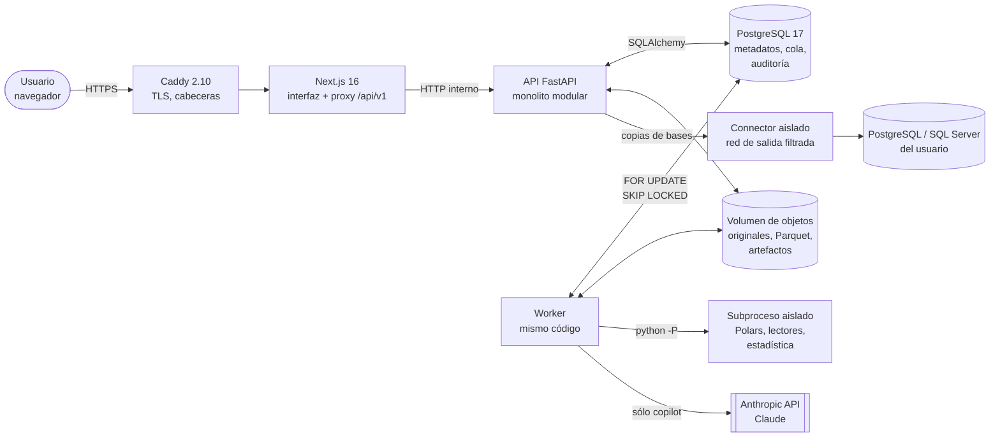

| Componente            | Responsabilidad                                                                                                                                                                                                                                                         |
| --------------------- | ----------------------------------------------------------------------------------------------------------------------------------------------------------------------------------------------------------------------------------------------------------------------- |
| Caddy                 | Única entrada pública: HTTPS automático (Let's Encrypt), cabeceras de seguridad, IP real para el límite de intentos.                                                                                                                                                    |
| Web (Next.js + React) | Interfaz en español por funcionalidad (`features/*`); proxy _same-origin_ `/api/v1/*` con límites de cuerpo y tiempo; tipos HTTP sólo del cliente generado desde OpenAPI.                                                                                               |
| API (FastAPI)         | 20 módulos con capas domain → application → infrastructure → presentation; 66 rutas / 69 operaciones; registra cargas, sirve resultados y encola trabajos.                                                                                                              |
| Worker                | Reclama trabajos de la cola (lease de 120 s, fencing, 3 intentos), ejecuta los planes paso a paso y publica artefactos de forma atómica; encadena los trabajos de fondo (inspección y comprensión al publicarse la carga; después investigación → dashboard → informe). |
| Subproceso aislado    | Lee fuentes y calcula con Polars en un proceso `python -P` con entorno mínimo, directorio temporal y tiempo máximo.                                                                                                                                                     |
| PostgreSQL            | 57 tablas: identidad, proyectos, datasets y versiones, cola de ejecuciones, artefactos, decisiones del usuario, consumo de IA y auditoría; 35 tablas con trigger de inmutabilidad.                                                                                      |
| Objetos               | Originales byte a byte (SHA-256), tablas canónicas en Parquet y artefactos JSON inmutables.                                                                                                                                                                             |
| IA (Anthropic)        | Explica resultados publicados y propone en esquemas cerrados; nunca recibe filas completas ni datos personales y nunca escribe cifras.                                                                                                                                  |
| Connector             | Servicio sin credenciales de DataFlow para copiar bases públicas tras un cortafuegos de salida.                                                                                                                                                                         |

### 3.2 Especificación de requerimientos técnicos

#### 3.2.1 Requerimientos funcionales

| ID   | Requerimiento                                                                                                                                                         | Prioridad | Objetivo |
| ---- | --------------------------------------------------------------------------------------------------------------------------------------------------------------------- | --------- | -------- |
| RF01 | Registrar cuenta, iniciar y cerrar sesión                                                                                                                             | Alta      | OE5      |
| RF02 | Crear, listar, editar y archivar proyectos propios                                                                                                                    | Alta      | OE2      |
| RF03 | Subir un CSV (UTF-8 o Windows-1252, separador detectado) o un Excel `.xlsx` y elegir automáticamente la hoja y la cabecera                                            | Alta      | OE2      |
| RF04 | Subir de 2 a 5 archivos relacionados y ver la foto del esquema antes de analizar                                                                                      | Alta      | OE2, OE3 |
| RF05 | Conectar un esquema de PostgreSQL o SQL Server (sólo lectura, sin guardar la contraseña)                                                                              | Media     | OE2      |
| RF06 | Detectar claves, relaciones, papeles de tabla y generar vistas de hechos y vista general                                                                              | Alta      | OE3      |
| RF07 | Inspeccionar el dataset: perfil por columna, calidad, atípicos, datos personales y diccionario corregible                                                             | Alta      | OE2      |
| RF08 | Limpiar sólo con transformaciones seguras y sin pérdida (p. ej. textos «sin dato» declarados → vacío), creando versiones derivadas con linaje y sin tocar el original | Alta      | OE1      |
| RF09 | Comprender el negocio: escalas de medida, grano, columnas calculadas, relaciones, objetivo y nombres de negocio                                                       | Alta      | OE2      |
| RF10 | Investigar automáticamente con pruebas estadísticas y corrección por comparaciones múltiples                                                                          | Alta      | OE1, OE2 |
| RF11 | Publicar un dashboard con indicadores, gráficos, filtros y origen de cada cifra                                                                                       | Alta      | OE2      |
| RF12 | Generar un informe y descargarlo en PDF; revisar hallazgos y pedir nuevas versiones                                                                                   | Alta      | OE2      |
| RF13 | Explicar resultados con IA citando cifras sólo por evidencia                                                                                                          | Media     | OE1      |
| RF14 | Mostrar el progreso por etapas de cada carga y encolar las cargas sin rechazarlas                                                                                     | Media     | OE4      |
| RF15 | Exportar la versión (CSV estándar / Excel regional) y descargar el original byte a byte                                                                               | Media     | OE5      |

#### 3.2.2 Requerimientos no funcionales (ISO/IEC 25010 [5])

| Característica                   | Requerimiento                                                                                                                                                                                              | Cómo se verifica                                          |
| -------------------------------- | ---------------------------------------------------------------------------------------------------------------------------------------------------------------------------------------------------------- | --------------------------------------------------------- |
| Eficiencia de desempeño          | p90 de lecturas < 500 ms; recorrido completo de 10.000 filas < 5 min; las cargas nunca se rechazan por ocupación: esperan en cola (3 trabajos en marcha por cuenta, una importación a la vez por proyecto) | §5.4.2, §5.4.3                                            |
| Adecuación funcional (exactitud) | Cifras exactas sobre todo el dataset (decimales exactos, sin muestreo); ninguna cifra producida por el LLM                                                                                                 | Pruebas _golden_, verificación `{{evidence:id}}` (§5.4.4) |
| Fiabilidad                       | Cola durable con reintentos y _fencing_; publicación atómica; recuperación de _leases_ vencidos                                                                                                            | Pruebas de ejecuciones e integración                      |
| Seguridad                        | Argon2id, sesión opaca, CSRF, control de `Origin`, autorización por propietario, sin credenciales de bases guardadas, cortafuegos de salida                                                                | §3.6, pruebas de identidad y fase 32                      |
| Mantenibilidad                   | Reglas de módulos verificadas por AST; mypy _strict_; operaciones y reglas versionadas; contrato OpenAPI regenerado por script                                                                             | `test_architecture.py`, CI                                |
| Usabilidad                       | Interfaz en español, sin formularios en el recorrido; nombres de negocio; detalle técnico plegado                                                                                                          | Protocolo SUS (Anexo G, pendiente)                        |
| Portabilidad                     | Contenedores Docker; mismo Compose en local y producción                                                                                                                                                   | Anexo D                                                   |
| Trazabilidad                     | Original y versiones inmutables, linaje, `effect_sha256`, auditoría y registro de cada llamada a la IA                                                                                                     | Triggers de inmutabilidad, pruebas de migraciones         |

### 3.3 Modelado del sistema

La solución es **híbrida**: se presentan los modelos de software (web) y, para la parte analítica y de IA,
el pipeline de datos, la formulación matemática y el pseudocódigo. No hay un modelo entrenado: el LLM se
usa como servicio y el motor es determinista, por lo que **no existe función de pérdida**; en su lugar se
formalizan las pruebas estadísticas y el control de falsos descubrimientos (§3.3.7).

#### 3.3.1 Casos de uso

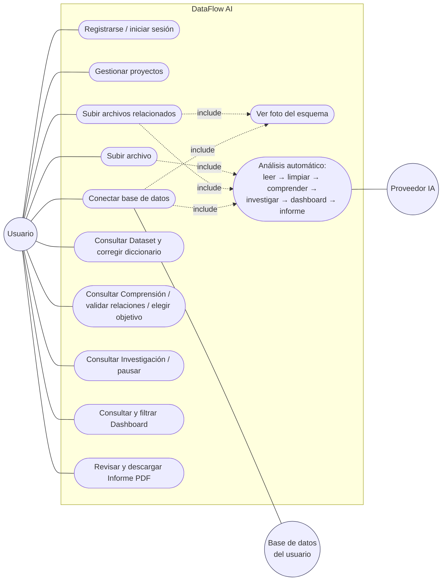

#### 3.3.2 Modelo entidad-relación (núcleo)

El esquema físico completo (57 tablas, 30 migraciones) está en el [Anexo C](anexos/C-base-de-datos.md).

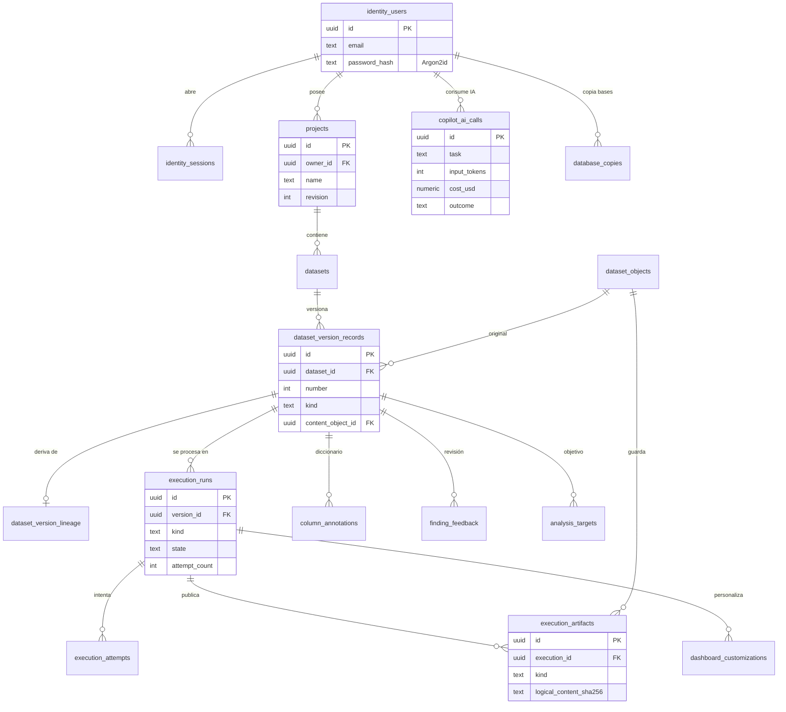

#### 3.3.3 Diagrama de secuencia — recorrido automático de una carga

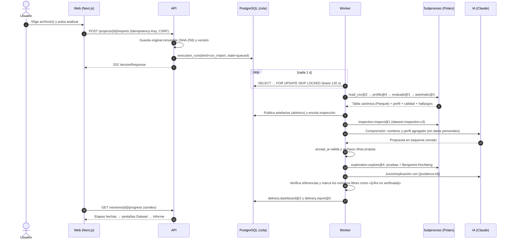

#### 3.3.4 Diagrama de secuencia — verificación de cifras de la IA

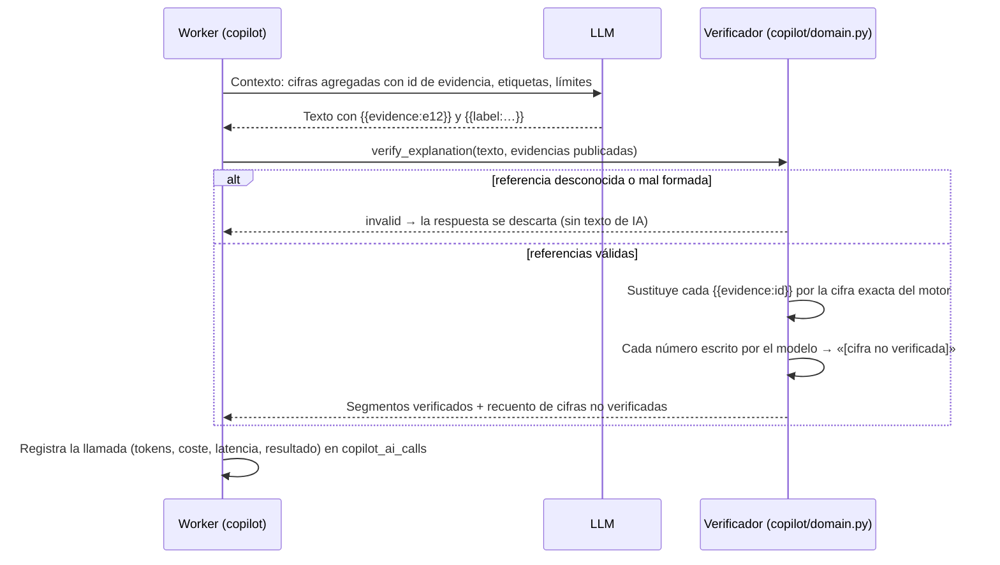

#### 3.3.5 Modelo de base de datos (físico)

Ver [Anexo C](anexos/C-base-de-datos.md): tablas, columnas principales, claves foráneas, migraciones
0001–0030 y triggers `dataflow_immutable_record()` (35 tablas) y `dataflow_legacy_fence()` (3 tablas
históricas de sólo lectura).

#### 3.3.6 Pantallas clave (capturas de alta fidelidad del sistema real)

Capturas de la versión evaluada con el conjunto `examples/relacionadas` (5 tablas), tomadas con
`docs/tddr/bench/screens.mjs` (Playwright, 1440×900). La explicación de la IA en estas capturas usa el
proveedor determinista de pruebas (`DATAFLOW_AI_PROVIDER=fake`) para no consumir presupuesto.

| #   | Pantalla                                                             | Archivo                                    |
| --- | -------------------------------------------------------------------- | ------------------------------------------ |
| 1   | Acceso (inicio de sesión / registro)                                 | 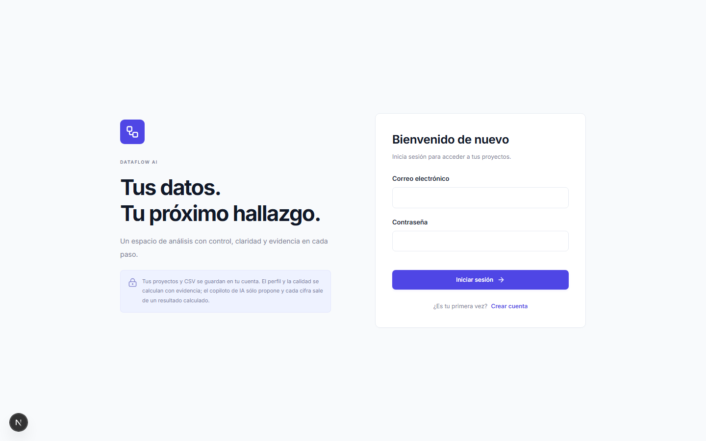               |
| 2   | Carga con tres opciones (varios archivos relacionados seleccionados) | 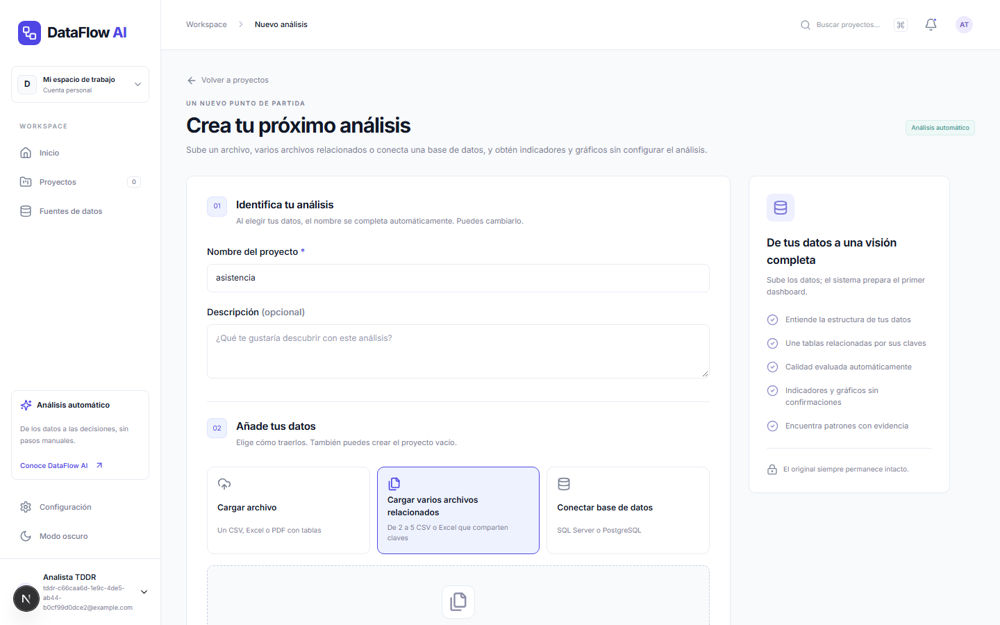   |
| 3   | Foto del esquema antes de analizar                                   | 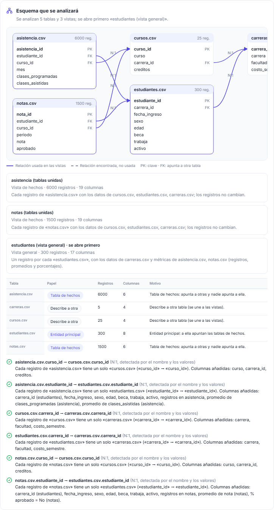    |
| 4   | Pestaña Dataset                                                      | 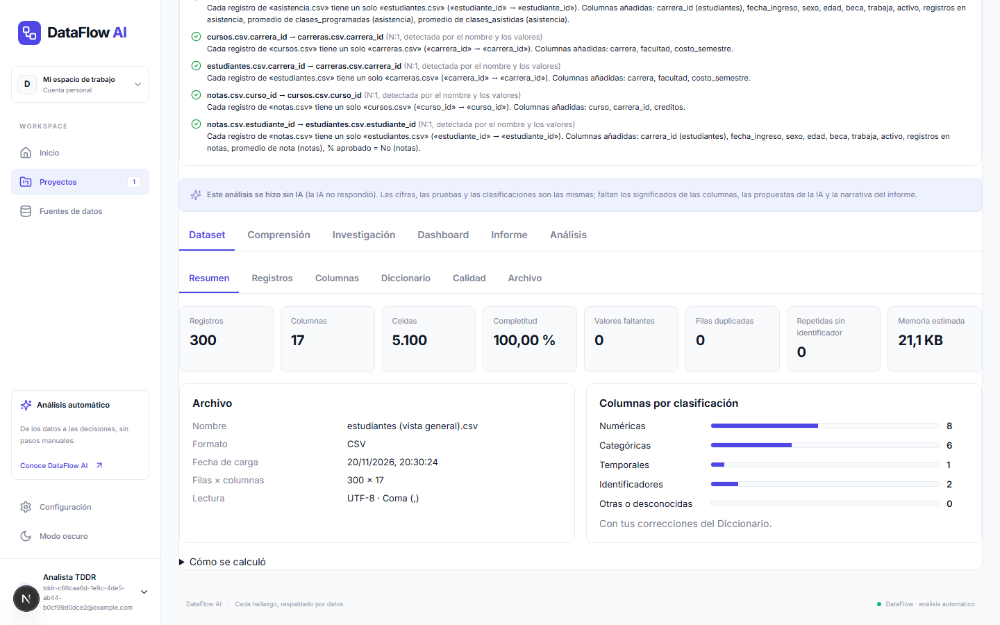             |
| 5   | Pestaña Comprensión                                                  | 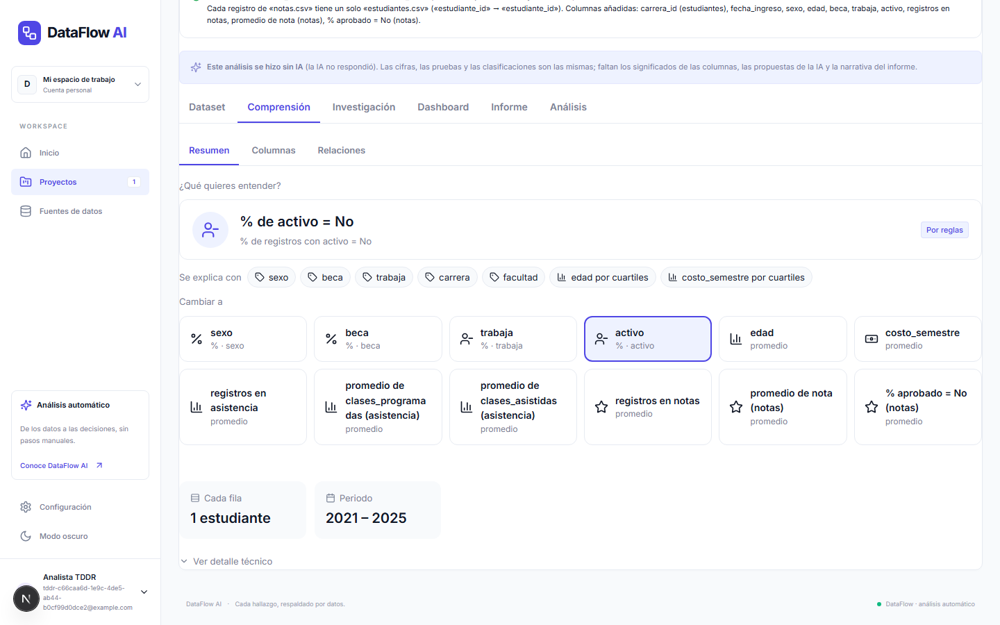     |
| 6   | Pestaña Investigación                                                | 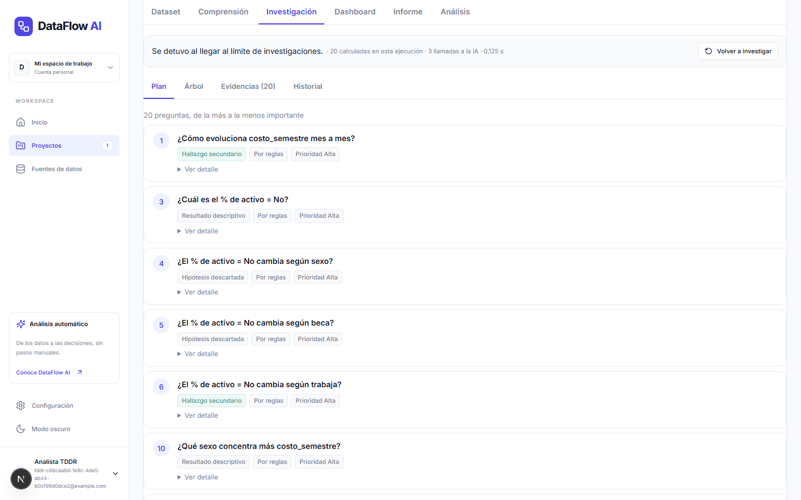 |
| 7   | Pestaña Dashboard                                                    | 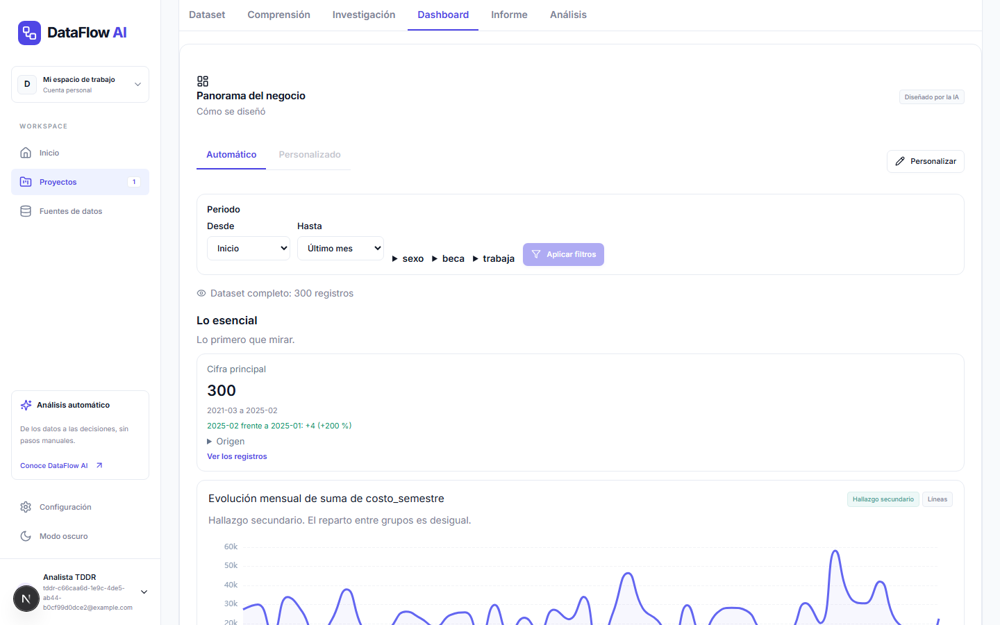         |
| 8   | Pestaña Informe                                                      | 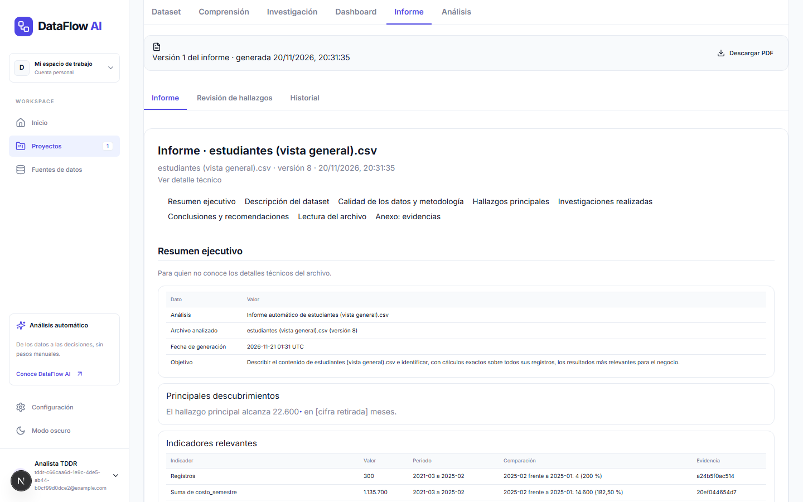             |

#### 3.3.7 Pipeline analítico, formulación y pseudocódigo

**Pipeline de datos → salida.**

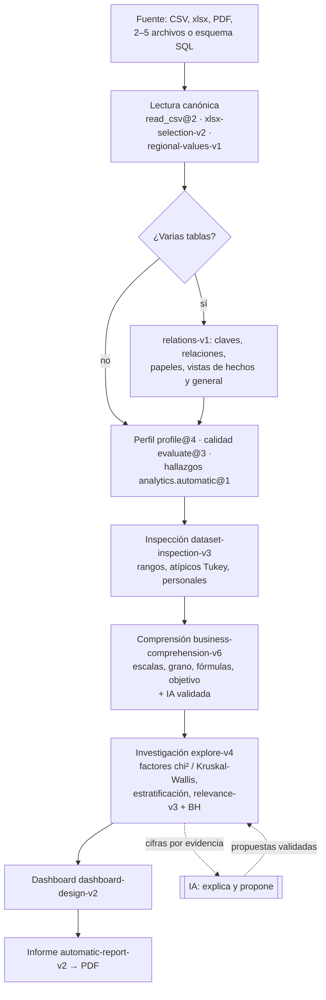

**Formulación de las pruebas de un factor.** Para un objetivo $Y$ y un factor $X$ con $k$ grupos:

- Si $Y$ es dicotómica (tasa), tabla de contingencia $k \times 2$ con frecuencias observadas $O_{ij}$ y
  esperadas $E_{ij} = \frac{R_i C_j}{N}$; estadístico de Pearson [3]:
  $$\chi^2 = \sum_{i=1}^{k}\sum_{j=1}^{2} \frac{(O_{ij}-E_{ij})^2}{E_{ij}}, \qquad gl = (k-1)$$
- Si $Y$ es numérica, prueba de Kruskal-Wallis [2] sobre los rangos $r$ de las $N$ observaciones, con
  $R_i$ la suma de rangos y $n_i$ el tamaño del grupo $i$:
  $$H = \frac{\frac{12}{N(N+1)} \sum_{i=1}^{k} \frac{R_i^2}{n_i} - 3(N+1)}{1 - \frac{\sum_t (t^3 - t)}{N^3 - N}}, \qquad H \sim \chi^2_{k-1}$$
  donde el denominador corrige los empates ($t$ = tamaño de cada grupo de valores empatados).
- **Relevancia** (`relevance-v3`): un hallazgo cuenta sólo si cada grupo comparado tiene al menos 10
  registros, la magnitud supera el umbral de la regla y $p < 0{,}05$.
- **Control de la tasa de falsos descubrimientos** (Benjamini-Hochberg [1]) sobre los $m$ hallazgos
  candidatos de una investigación, con $p_{(1)} \le \dots \le p_{(m)}$:
  $$q_{(i)} = \min_{j \ge i} \left\{ \min\left(1, \frac{m\, p_{(j)}}{j}\right) \right\}$$
  y sólo se publican como relevantes los hallazgos con $q < 0{,}05$.

**Pseudocódigo — `relations-v1` (algoritmo principal de varias tablas).**

```text
entrada: tablas T (celdas canónicas), claves foráneas declaradas D
para cada tabla B, para cada columna k de B sin vacíos ni repetidos:      # claves
    para cada tabla A ≠ B, para cada columna c de A:
        si (A.c → B.k) ∈ D  o  afinidad(c, B, k):                          # nombre
            candidata(A.c → B.k)
para cada candidata:
    si algún valor de A.c no está en B.k  o  |valores(A.c)| < 2: descartar con motivo
    si no: válida; cardinalidad = 1:1 si A.c no se repite, si no N:1
si una columna A.c es válida hacia varias tablas: descartarlas todas (ambigua)
hechos   = tablas que apuntan a otras y a las que nadie apunta
entidad  = tabla a la que apuntan más tablas de hechos
para cada tabla de hechos H: vista(H) = H ⋈ (N:1, ≤ 2 pasos), mismos registros
vista general(entidad) = entidad + dimensiones + por cada H: nº de registros,
                         promedio de cada número, % de la categoría menos frecuente
principal = vista general si |hechos| ≥ 2; si no, vista de hechos; si no, tabla mayor
```

**Pseudocódigo — ciclo de investigación (`investigation-v4`).**

```text
plan ← consultas por reglas (objetivo × factores, evolución, cambio de periodo, atípicos)
mientras queden consultas y no se supere el límite de tiempo, llamadas o coste:
    si el usuario pausó/canceló (investigation_controls): detener
    resultado ← motor.explore@4(consulta)                    # cálculo exacto (Polars)
    p ← prueba(resultado)                                     # chi² o Kruskal-Wallis
    clase ← relevance-v3(resultado, p, mínimo 10 por grupo)
    juicio ← IA.juzgar(resultado ≤ 100 filas)                 # sólo puede rebajar la clase
    hijos ← validar(IA.proponer(...))                         # esquema cerrado; si no valida, se descarta
    plan ← plan ∪ hijos
q ← Benjamini-Hochberg(p de todos los candidatos); publicar sólo q < 0,05
```

### 3.4 Stack tecnológico justificado

| Capa               | Tecnología                                        | Versión                       | Justificación técnica                                                                                              | Alternativa descartada                                                                                     |
| ------------------ | ------------------------------------------------- | ----------------------------- | ------------------------------------------------------------------------------------------------------------------ | ---------------------------------------------------------------------------------------------------------- |
| Frontend           | Next.js + React                                   | 16.4.5 / 19.3.1               | Enrutado y proxy _same-origin_ en el mismo servidor (cookies HttpOnly sin CORS); compilación estática del cliente  | SPA con Vite + CORS (expondría la API y complicaría CSRF)                                                  |
| Estado y datos web | TanStack Query                                    | 5.104.5                       | Caché y sondeo del progreso por etapas                                                                             | Redux (más código para datos de servidor)                                                                  |
| Gráficos           | ECharts                                           | 6.1.0                         | Barras, líneas, mapas de calor, tartas y dispersión con buen rendimiento                                           | Chart.js (menos tipos), D3 (más bajo nivel)                                                                |
| Tipos HTTP         | Cliente generado desde OpenAPI                    | `schema.ts`                   | Un solo contrato; la CI falla si el cliente no coincide                                                            | Tipos escritos a mano                                                                                      |
| Backend            | FastAPI + Pydantic                                | 0.160.0 / 2.14.1              | Validación y OpenAPI desde los mismos modelos; tipado (mypy _strict_)                                              | Django REST (más acoplado al ORM), Flask (sin validación ni OpenAPI nativos)                               |
| Lenguaje           | Python                                            | 3.12.10                       | Ecosistema de datos; misma base de código para API, worker y cálculo                                               | Node para el backend (ecosistema analítico pobre)                                                          |
| Motor de datos     | Polars                                            | 1.44.2                        | Columnar (Arrow), multihilo, expresiones perezosas, sin índices implícitos; cálculos exactos sobre todo el dataset | pandas (más memoria, tipos laxos), DuckDB (SQL embebido; se prohibió por arquitectura para un único motor) |
| Estadística        | Python puro (`statistics.py`)                     | —                             | chi², Kruskal-Wallis, BH e intervalos sin dependencias pesadas y auditables                                        | SciPy (dependencia grande para pocas funciones)                                                            |
| Persistencia       | PostgreSQL + SQLAlchemy + Alembic                 | 17 / 2.1.6 / 1.20.1           | Transacciones, `SKIP LOCKED` para la cola, triggers de inmutabilidad, migraciones con prueba de ida y vuelta       | MongoDB (sin transacciones relacionales ni triggers), SQLite (concurrencia limitada)                       |
| Cola               | Tabla `execution_runs` en PostgreSQL              | —                             | Cola durable sin infraestructura adicional; _lease_ y _fencing_                                                    | Celery + Redis/RabbitMQ (otro servicio que operar)                                                         |
| IA                 | Anthropic SDK (Claude)                            | 2.6.0                         | Salidas estructuradas validadas, esfuerzo configurable; un único adaptador tras el puerto `AIProvider`             | Llamar al LLM para calcular (no fiable [38], [45])                                                         |
| Informe            | ReportLab                                         | 5.1.0                         | PDF generado en el servidor sin navegador                                                                          | wkhtmltopdf / Chromium sin cabeza (más pesado)                                                             |
| Fuentes            | Lector OOXML propio, pdfplumber, psycopg, pymssql | —, 0.11.10, 3.3.6, 2.4.6      | `.xlsx` sin dependencias; PDF con tablas; bases de datos sólo en el subproceso                                     | openpyxl (dependencia adicional para lo que se necesita)                                                   |
| Identidad          | argon2-cffi                                       | 25.1.0                        | Argon2id recomendado para contraseñas                                                                              | bcrypt (sin resistencia a memoria configurable)                                                            |
| Pruebas            | pytest, Playwright, ruff, mypy                    | 9.1.1, 1.64.1, 0.17.1, 1.20.2 | Unitarias, integración con PostgreSQL real, AST, E2E en navegador y análisis estático                              | Jest + Cypress (dos ecosistemas de prueba)                                                                 |
| Despliegue         | Docker Compose, Caddy, GHCR, GitHub Actions       | Caddy 2.10                    | Misma composición en local y producción; HTTPS automático; imágenes inmutables por commit                          | Kubernetes (excesivo para un servidor), PaaS sin volumen compartido                                        |

### 3.5 Decisiones de diseño críticas (ADR simplificados)

El proyecto registra 44 ADR (ADR-009 a ADR-052, en `docs/adr/`). Se resumen los cinco más
determinantes.

**ADR-026 — Un solo recorrido completamente automático.**

- _Decisión:_ subir → leer → perfilar → evaluar → limpiar → analizar → publicar → explicar, sin
  aprobaciones, políticas ni formularios; el motor decide con reglas versionadas.
- _Contexto:_ las Fases 4–11 tenían un recorrido supervisado (aprobar efectos, definir métricas) y otro
  gobernado por políticas; el producto pasó a exigir cero interacción manual.
- _Alternativas:_ mantener el recorrido supervisado; automatización por políticas configuradas por el
  usuario (ADR-023).
- _Consecuencias:_ se retiró el pipeline por políticas (migración 0019, la única no aditiva, decidida
  explícitamente); ante la duda el sistema no transforma y explica la limitación; las decisiones quedan
  registradas como decisiones del sistema.

**ADR-022 / ADR-033 — La IA explica y propone; el motor calcula.**

- _Decisión:_ puerto `AIProvider` con un único adaptador; cifras sólo como `{{evidence:id}}`; las
  propuestas de la IA se expresan en un esquema cerrado que Python valida antes de que el motor las
  calcule.
- _Contexto:_ los LLM se equivocan calculando y alucinan cifras [38], [39], [45].
- _Alternativas:_ que el LLM genere SQL o código (como [36], [41]); verificar a posteriori con otro LLM
  (como [46]).
- _Consecuencias:_ ninguna cifra sale del modelo; la respuesta con referencias inválidas se descarta; el
  sistema funciona (sin texto de IA) cuando la IA no está disponible; mayor esfuerzo de validación.

**ADR-010 / ADR-028 — Cola durable en PostgreSQL y cargas que esperan.**

- _Decisión:_ la tabla `execution_runs` es la cola; el worker reclama con `FOR UPDATE SKIP LOCKED`,
  _lease_ de 120 s, _fencing_ y 3 intentos; las cargas nunca se rechazan por ocupación (hasta 50
  pendientes y 3 en marcha por cuenta).
- _Contexto:_ el análisis dura de segundos a minutos y no puede bloquear peticiones HTTP; rechazar
  cargas obligaba a reintentar a mano.
- _Alternativas:_ Celery con Redis o RabbitMQ; reintentos desde la interfaz.
- _Consecuencias:_ sin infraestructura adicional y con transacciones compartidas; el throughput de la
  cola está limitado por PostgreSQL, suficiente para la escala del proyecto.

**ADR-049 — Modelo de datos de tablas relacionadas (`relations-v1`).**

- _Decisión:_ regla pura que detecta claves y relaciones por nombre y contención total de valores, y
  analiza cada tabla, cada vista de hechos y una vista general por entidad como versiones propias; la
  decisión se guarda en el plan inmutable (sin migración).
- _Contexto:_ el docente pidió analizar varias tablas relacionadas y bases de datos con una vista de
  negocio común.
- _Alternativas:_ uniones dentro de cada consulta de la investigación; _schema matching_ con modelos de
  lenguaje [34], [48]; aceptar relaciones con valores sin pareja.
- _Consecuencias:_ reutiliza todo el recorrido; precisión máxima a costa de no unir columnas con nombres
  libres o con valores huérfanos (§5.4.1); sólo claves de una columna.

**ADR-052 — Despliegue en un servidor Linux con Docker Compose.**

- _Decisión:_ VPS Ubuntu 24.04 con la misma composición que en local más una capa de producción; Caddy
  como única entrada; imágenes compiladas en GitHub Actions y publicadas en GHCR; despliegue por SSH al
  fusionar en `main` con vuelta atrás automática; copia de seguridad diaria.
- _Contexto:_ la API y el worker comparten un volumen de objetos y el conector necesita un cortafuegos
  de salida en el anfitrión.
- _Alternativas:_ nube gestionada (exigiría almacenamiento de objetos), Render/Railway/Vercel (sin
  volumen compartido ni cortafuegos), Kubernetes.
- _Consecuencias:_ despliegue simple y reproducible; un solo servidor (sin escalado horizontal); un
  despliegue interrumpe las copias de bases en curso.

### 3.6 Modelo de seguridad y privacidad

**Autenticación.** Contraseñas con **Argon2id**; verificación igual de costosa si el correo no existe
(evita enumeración por tiempo). Sesión opaca de 384 bits en cookie `HttpOnly`, `SameSite=Lax` y `Secure`
en producción; en la base sólo se guarda su SHA-256; caducidad de 12 h. Límite de 15 intentos por correo y
100 por IP cada 15 min (claves SHA-256, bloqueo consultivo) → 429.

**Autorización.** Modelo de propietario: toda tabla de negocio lleva `owner_id`; un usuario no puede
listar, leer ni modificar proyectos, versiones, copias o resultados ajenos.

**Protección de peticiones.** Token CSRF por sesión en `X-CSRF-Token` comparado en tiempo constante;
rechazo de `Origin` no permitido (403); claves de idempotencia en las cargas; límites de tamaño en el proxy
de Next (5 MiB por archivo), en Caddy (20 MB) y en la API; `uvicorn --limit-concurrency 32`.

**Cifrado.** HTTPS con Let's Encrypt (HSTS de un año) en producción; conexiones a PostgreSQL públicas con
`sslmode=verify-full`; SQL Server con cifrado obligatorio. Los secretos (clave de IA, token del conector)
son secretos de Docker y `SecretStr`, nunca variables en el repositorio.

**Fuentes externas.** Las contraseñas de bases de datos sólo viven en memoria durante la copia (ni en
base, ni en cola, ni en disco). La regla `database-destination-v1` sólo admite direcciones globales,
niega la propia base y una lista configurable, fija la IP resuelta (contra _DNS rebinding_) y se aplica
en la API y otra vez en el subproceso. El servicio `connector` corre sin credenciales de DataFlow, con
sistema de archivos de sólo lectura, sin capacidades y tras un cortafuegos de salida que niega rangos
privados y metadatos de nube.

**Aislamiento del cálculo.** El subproceso de lectura y cálculo se lanza con `python -P`, sin variables
`DATAFLOW_*`, `PG*` ni proxies, en su propio directorio temporal y con tiempo máximo.

**Privacidad y IA.** Las columnas reconocidas como datos personales (por reglas o marcadas por el usuario)
**no se envían a la IA**. Al modelo sólo llegan nombres, perfil agregado, cifras con identificador de
evidencia y, en la investigación, como mucho 100 filas agregadas por resultado; nunca el archivo. Cada
llamada se registra (tokens, coste, latencia, resultado) y cuenta para un presupuesto diario por usuario
(1.000.000 de tokens) y mensual por proyecto (50 USD); al agotarse, los trabajos con IA esperan.

**Integridad y auditoría.** Originales y artefactos inmutables (35 tablas con trigger que impide
`UPDATE`/`DELETE`), hash canónico de cada efecto, eventos de auditoría con `correlation_id`.

---

## Sección 4 — Desarrollo e implementación

### 4.1 Metodología de desarrollo aplicada

Se siguió un proceso **iterativo e incremental por fases**, cercano a **Design Science Research**
(construir un artefacto, evaluarlo y refinarlo) con prácticas de Kanban (flujo continuo, una fase en curso
por rama). Se eligió frente a Scrum porque el equipo es de dos personas sin roles separados y los
requisitos cambiaron de enfoque durante el proyecto (de supervisado a completamente automático, ADR-026),
lo que pedía iteraciones cortas con una decisión documentada en cada una.

Cada fase tuvo como entregables: (1) una propuesta corta con las contradicciones detectadas y las
decisiones que bloquean; (2) backend (dominio, migración aditiva, API, contrato OpenAPI y cliente
regenerados, pruebas); (3) interfaz, E2E y documentación (`docs/architecture/phase-N.md`, un ADR nuevo y
la versión de la API); (4) la batería completa en verde y un PR hacia `develop`.

| Iteración  | Fechas (2026) | API       | Entregables principales                                                                                             |
| ---------- | ------------- | --------- | ------------------------------------------------------------------------------------------------------------------- |
| Fases 1–3  | 30 oct –      | 0.5       | Contratos, identidad, datasets y ejecuciones separados, semántica                                                   |
| Fases 4–7  |               | 0.6–0.11  | Planes versionados, catálogo, limpieza, tipos, calidad, analítica con evidencia                                     |
| Fases 8–12 |               | 0.12–0.14 | Dashboards, informes PDF, copiloto IA, importación Excel                                                            |
| A–C, 13–15 |               | 0.17–0.22 | Recorrido automático único, cola, perfil y calidad automáticos, plan y hallazgos                                    |
| 16–18      |               | 0.23–0.25 | Investigación con IA validada, informe automático, fuentes regionales y SQL Server                                  |
| 19–24B     |               | 0.26–0.32 | Comprensión del negocio, exploración, dashboard adaptado, pestañas Dataset y Comprensión                            |
| 25–30      |               | 0.33–0.38 | Pestañas Investigación, Dashboard e Informe; criterio analítico; objetivo y significancia; interfaz clara           |
| 31–33      | – 20 nov      | 0.39–0.42 | Tablas relacionadas y foto del esquema; PostgreSQL y bases públicas con conector; todas las tablas en segundo plano |
| Despliegue | 20 nov        | 0.42      | Producción con Caddy, GHCR y despliegue automático; túnel Cloudflare                                                |

La lista completa de fases, con su versión de API, está en `CLAUDE.md` y en `docs/architecture/`.

### 4.2 Descripción técnica de módulos implementados

El backend tiene 20 módulos en `apps/api/src/dataflow/modules/`, cada uno con capas
domain → application → infrastructure → presentation; entre módulos sólo se importa `public` o
`contracts`, y las dependencias son acíclicas (verificado por AST).

| Módulo                          | Función técnica                                                                                  |
| ------------------------------- | ------------------------------------------------------------------------------------------------ |
| `identity`, `projects`, `audit` | Cuentas, sesiones, proyectos con revisión y eventos de auditoría                                 |
| `datasets`                      | Datasets, versiones inmutables, objetos, linaje y cuotas                                         |
| `ingestion`                     | Cargas de CSV/XLSX/PDF, archivos relacionados y bases; subproceso de lectura; `relations-v1`     |
| `understanding`, `quality`      | Perfil `profile@4`, interpretación, calidad `evaluate@3`                                         |
| `planning`, `executions`        | Planes versionados y catálogo (validación pura); cola, intentos, _leases_, artefactos            |
| `cleaning`                      | Operaciones seguras, efecto exacto (`effect_sha256`) y versión derivada                          |
| `analytics`                     | Consultas `query@1..@3`, hallazgos `automatic@1`, evidencia por cifra                            |
| `inspection`                    | Pestaña Dataset: `dataset-inspection-v3` (reglas puras + Polars sólo en `engine.py`)             |
| `comprehension`                 | Escalas, grano, fórmulas, relaciones, objetivo, nombres de negocio (`business-comprehension-v6`) |
| `exploration`                   | Investigación: lenguaje cerrado `explore-v4`, motor exacto, plan, relevancia y estadística       |
| `copilot`                       | Toda llamada a la IA: prompts versionados, validación, verificación de cifras y presupuesto      |
| `delivery`, `curation`          | Dashboard, informe y PDF; marcas «sí va / no va» y personalización                               |
| `investigation`                 | Seguimiento de hallazgos (v1, Fase 16)                                                           |

A continuación, los fragmentos más representativos (copiados del código, ≤ 20 líneas).

**(1) `relations-v1`: afinidad por nombre** (`ingestion/relations.py:145-157`). Una columna sólo es
candidata a clave foránea si se llama igual que la clave (salvo `id` contra `id`) o si combina una clave
genérica con la raíz del nombre de la otra tabla (`id_cliente` → `clientes.id`).

```python
def affinity(column: str, parent: Table, key: str) -> bool:
    child, target = normalize(column), normalize(key)
    if not child or not target:
        return False
    if child == target:
        # La misma columna en las dos tablas; `id` contra `id` no dice nada.
        return target not in KEY_NAMES
    roots = stems(parent.label)
    reference = generic(child, roots)
    if reference is None:
        return False
    return target in {reference, *(reference + r for r in roots), *(r + reference for r in roots)}
```

**(2) `relations-v1`: contención total** (`ingestion/relations.py:179-192`). Decisión no trivial: se exige
que **todos** los valores existan en la clave; una unión con valores sin pareja perdería o inventaría
registros, así que se prefiere no unir y explicar el motivo.

```python
def containment(child: Table, column: int, parent: Table, key: int) -> str | None:
    """None si todos los valores de la columna están en la clave; si no, el motivo."""
    values = {row[column] for row in child.rows if row[column] is not None}
    if len(values) < 2:
        return f"«{child.headers[column]}» tiene menos de dos valores distintos."
    available = {row[key] for row in parent.rows}
    missing = len(values - available)
    if missing:
        return (
            f"{missing} valor(es) de «{child.headers[column]}» no están en "
            f"«{parent.label}.{parent.headers[key]}»: unirlas dejaría registros sin pareja."
        )
    return None
```

**(3) Cifras de la IA sólo por evidencia** (`copilot/domain.py:86-100`). Todo número escrito libremente
por el modelo se sustituye por una marca visible y se cuenta; las cifras reales sólo entran por
`{{evidence:id}}`, que Python resuelve contra los resultados publicados.

```python
def free_text(text: str) -> tuple[list[Segment], int]:
    """Texto escrito por el modelo: cada número se sustituye por una marca visible."""
    segments: list[Segment] = []
    count = 0
    position = 0
    for match in NUMBER.finditer(text):
        if match.start() > position:
            segments.append(Segment(kind="text", text=text[position : match.start()]))
        segments.append(Segment(kind="unverified", text=UNVERIFIED))
        count += 1
        position = match.end()
    if position < len(text):
        segments.append(Segment(kind="text", text=text[position:]))
    return merge(segments), count
```

**(4) Benjamini-Hochberg en Python puro** (`exploration/statistics.py:209-219`).

```python
def benjamini_hochberg(p_values: Sequence[float]) -> list[float]:
    """Valores q (tasa de falsos descubrimientos) en el mismo orden que los p."""
    m = len(p_values)
    order = sorted(range(m), key=lambda i: p_values[i])
    adjusted = [0.0] * m
    previous = 1.0
    for position in range(m - 1, -1, -1):
        index = order[position]
        value = min(previous, p_values[index] * m / (position + 1))
        adjusted[index] = previous = min(1.0, value)
    return adjusted
```

**(5) Hash canónico de efectos** (`platform/canonical.py:9-30`, extracto). La serialización canónica
(claves ordenadas, enteros seguros, UTF-8 estricto) hace que el mismo efecto produzca siempre el mismo
`effect_sha256`, con un dominio separado por tipo de objeto.

```python
def canonical(value: Any) -> str:
    if value is None or isinstance(value, (str, bool)):
        if isinstance(value, str):
            value.encode("utf-8", errors="strict")
        return json.dumps(value, ensure_ascii=False, separators=(",", ":"))
    if isinstance(value, int) and abs(value) <= 2**53 - 1:
        return str(value)
    if isinstance(value, list):
        return "[" + ",".join(canonical(item) for item in value) + "]"
    ...
    raise ValueError("CANONICAL_UNSUPPORTED_VALUE")

def digest(domain: str, value: Any) -> str:
    return hashlib.sha256(f"dataflow:{domain}:v1\n{canonical(value)}".encode()).hexdigest()
```

**(6) Arquitectura verificada por AST** (`tests/test_architecture.py:31-39`). Las reglas de módulos no son
una convención: una importación prohibida rompe la batería.

```python
def test_cross_module_imports_use_public_contracts() -> None:
    root = Path(__file__).resolve().parents[1] / "src" / "dataflow" / "modules"
    for file in root.rglob("*.py"):
        own = file.relative_to(root).parts[0]
        for module in imports(ast.parse(file.read_text(encoding="utf-8"))):
            if module.startswith("dataflow.modules."):
                parts = module.split(".")
                if parts[2] != own:
                    assert len(parts) >= 4 and parts[3] in {"public", "contracts"}, (file, module)
```

**Flujo interno del worker.**

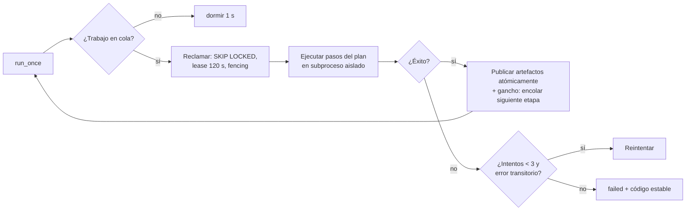

**Otras decisiones de implementación no triviales.**

- _Columnas por ID, nunca por nombre_, y alias neutros en Polars: evita colisiones con nombres de columnas
  del usuario y permite renombrar sin recalcular.
- _Decimales exactos_: las métricas se calculan con `Decimal` y se muestran con 3 decimales como mucho
  sin redondear los cálculos (ADR-042).
- _Operaciones y reglas versionadas_ (`modulo.nombre@N`, `regla-vN`): cambiar la semántica crea una
  versión nueva; los planes guardados conservan la suya.
- _Trabajos de fondo después de las cargas_: la inspección, comprensión, investigación, dashboard e
  informe se reclaman detrás de cualquier carga, para que una carga nueva nunca espere a un análisis.
- _IA con presupuesto aplazable_: si se agota, el trabajo queda `deferred` hasta el siguiente periodo
  en lugar de fallar (Fase 33).

### 4.3 Gestión de datos

#### 4.3.1 Fuentes de datos

DataFlow AI no tiene un dataset propio de entrenamiento: procesa los datos de cada usuario. Para la
evaluación se usaron:

| Conjunto                                  | Origen                                                                    | Volumen                                 | Formato    | Licencia     |
| ----------------------------------------- | ------------------------------------------------------------------------- | --------------------------------------- | ---------- | ------------ |
| `examples/ventas_calidad.csv`             | Repositorio (sintético, con problemas de calidad)                         | 6 registros                             | CSV        | Del proyecto |
| `examples/relacionadas/`                  | Repositorio (sintético: estudiantes, carreras, cursos, notas, asistencia) | 5 tablas, 7.830 registros               | CSV        | Del proyecto |
| Esquemas de `relations_benchmark.py`      | Generados con semilla 2026                                                | 200 esquemas, 718 relaciones verdaderas | En memoria | Del proyecto |
| CSV de escalabilidad (`api_benchmark.py`) | Generados con semilla = nº de filas                                       | 1.000, 10.000 y 50.000 filas            | CSV        | Del proyecto |
| `tests/reference_sales.py`                | Dataset de aceptación sintético de las pruebas                            | —                                       | En memoria | Del proyecto |

Todos son sintéticos y reproducibles: no se usaron datos personales reales. Descripción y acceso en el
[Anexo E](anexos/E-datasets.md).

#### 4.3.2 Preprocesamiento

El preprocesamiento es parte del producto y se aplica igual a cualquier carga:

1. **Lectura canónica** (`read_csv@2`): detección de codificación (UTF-8 / Windows-1252) y separador;
   `regional-values-v1` reescribe una columna a su celda canónica sólo si **todos** sus valores admiten
   una única lectura (p. ej. `1.234,5` → `1234.5`); si no, la deja como texto con el motivo.
2. **Excel** (`xlsx-selection-v2`): elige la hoja/tabla principal y su fila de cabecera; las demás tablas
   con datos se analizan como versiones propias.
3. **Tipos y perfil** (`profile@4`): tipos inferidos sobre todo el dataset, nulos, distintos, rangos,
   distribuciones; escala de medida (nominal, ordinal, intervalo, razón).
4. **Calidad** (`evaluate@3`) e **inspección** (`dataset-inspection-v3`): vacíos, duplicados, rangos
   esperados por nombre, atípicos por regla de Tukey (fuera de $[Q_1 - 1{,}5\,IQR,\ Q_3 + 1{,}5\,IQR]$),
   columnas dicotómicas, ordinales candidatas y datos personales.
5. **Limpieza segura**: en el recorrido actual, la única transformación que se aplica sola es la
   normalización de los textos «sin dato» que el usuario declara en el diccionario
   (`cleaning.normalize_null_tokens@1`, trabajo `null_cleaning`), con las escrituras exactas que encontró
   la inspección; crea una **versión derivada** con linaje y `effect_sha256` que se analiza como una carga
   nueva. Los demás problemas (espacios, duplicados, atípicos, vacíos) se **señalan** y se explican, pero
   no se corrigen: no se imputan valores, no se borran filas ni se eliminan atípicos. Los motores
   `trim_whitespace@1`, `deduplicate@1` y `cast@1` se conservan versionados.
6. **Relaciones** (`relations-v1`) cuando hay varias tablas (§3.3.7).

**Estadísticas descriptivas del conjunto de evaluación principal** (`examples/relacionadas`):

| Tabla           | Registros | Columnas | Papel detectado |
| --------------- | --------- | -------- | --------------- |
| asistencia.csv  | 6.000     | 6        | ver §5.4.2      |
| notas.csv       | 1.500     | 6        | ver §5.4.2      |
| estudiantes.csv | 300       | 8        | ver §5.4.2      |
| cursos.csv      | 25        | 4        | ver §5.4.2      |
| carreras.csv    | 5         | 4        | ver §5.4.2      |

Las estadísticas por columna (media, desviación, distribución y valores faltantes) las calcula el propio
sistema en la pestaña Dataset; las de este conjunto están en el [Anexo E](anexos/E-datasets.md).

#### 4.3.3 Partición de datos

**No aplica.** DataFlow AI no entrena modelos de aprendizaje automático: el motor es determinista y el
LLM se usa como servicio sin ajuste fino, por lo que no hay conjuntos de entrenamiento, validación y
prueba. La evaluación de la detección de relaciones (§5.4.1) usa esquemas generados con verdad de
referencia y un _bootstrap_ por esquemas para los intervalos de confianza.

### 4.4 Configuración del entorno de desarrollo y producción

| Aspecto       | Desarrollo / evaluación                                                  | Producción                                                                                                                               |
| ------------- | ------------------------------------------------------------------------ | ---------------------------------------------------------------------------------------------------------------------------------------- |
| Hardware      | PC de escritorio: Intel Core i5-9400F (6 núcleos, 2,9 GHz), 16 GB de RAM | VPS Ubuntu 24.04 (mínimo recomendado 4 vCPU, 8 GB, 80 GB)                                                                                |
| Sistema       | Windows 10 Enterprise (10.0.19045)                                       | Ubuntu 24.04 LTS                                                                                                                         |
| Base de datos | PostgreSQL 17 en Docker Desktop                                          | `postgres:17-alpine` en Docker Compose                                                                                                   |
| Ejecución     | `python -m dataflow.bootstrap.run --with-worker` y `next dev`            | Contenedores `api`, `worker`, `web`, `connector`, `caddy`, `postgres`                                                                    |
| Despliegue    | —                                                                        | Imágenes en GHCR por commit; `deploy.sh` por SSH al fusionar en `main`, con vuelta atrás; túnel Cloudflare como alternativa sin servidor |

Versiones exactas de dependencias: `apps/api/requirements.lock` (backend, instalado con
`pip install -c requirements.lock -e ".[dev]"`), `apps/api/pyproject.toml`, `package.json`,
`apps/web/package.json` y `package-lock.json`. Instrucciones completas en el
[Anexo D](anexos/D-instalacion.md).

### 4.5 Control de versiones y trazabilidad

- **Estrategia de ramas**: GitFlow simplificado. Cada fase en `feat/fase-N-*` → PR a `develop` →
  PR de `develop` a `main`; desde el 9 de noviembre, siempre por PR (sin fusiones locales). Fusionar en
  `main` despliega a producción.
- **Commits convencionales en español** (`feat(fase-31): …`, `fix(…)`, `docs(…)`, `test(…)`).
- **Cifras del repositorio** (a 20 de noviembre de 2026, `main` en `64a3e45`):

| Indicador               | Valor                                                                                                    |
| ----------------------- | -------------------------------------------------------------------------------------------------------- |
| Commits en `main`       | 134 (primer commit: 30-10-2026; último: 20-11-2026)                                                      |
| Fusiones (merges)       | 52                                                                                                       |
| Pull requests           | 43 (40 fusionados, 3 cerrados)                                                                           |
| Autores en el historial | 3 identidades de git (dos integrantes)                                                                   |
| Releases / etiquetas    | Ninguna etiqueta; cada fase sube la versión de la API (0.5 → 0.42) y la registra en su documento de fase |
| ADR                     | 44 (ADR-009 a ADR-052) + `decisions.md` inicial                                                          |
| Documentos de fase      | 33 fases con subfases (`docs/architecture/phase-*.md`)                                                   |
| Migraciones             | 30 (0001–0030); 22 con prueba propia de ida y vuelta (0003–0012 y 0018–0029)                             |
| Código                  | 47.966 líneas de Python (`src`), 21.276 de pruebas, 2.522 de migraciones, 12.308 de TS/TSX, 1.514 de E2E |

- **Trazabilidad de requisitos a código**: cada fase enlaza su ADR, su documento y su PR; cada operación y
  regla lleva versión; el contrato OpenAPI (`contracts/openapi/dataflow.json`) y el cliente se
  regeneran por script y la CI falla si difieren.

---

## Sección 5 — Evaluación y validación

### 5.1 Estrategia de evaluación

Se evalúan los cuatro aspectos que sostienen la pregunta de investigación, con validación **técnica** y
**experimental comparativa** (no hubo validación con usuarios; ver §6.3):

| Qué se evalúa                                            | Por qué                                                                                     | Tipo                                                                | Objetivo |
| -------------------------------------------------------- | ------------------------------------------------------------------------------------------- | ------------------------------------------------------------------- | -------- |
| Exactitud de la detección de relaciones (`relations-v1`) | Una relación falsa une tablas que no se corresponden y contamina todo el análisis posterior | Experimental comparativa con verdad de referencia y dos líneas base | OE3      |
| Recorrido automático completo                            | La solución sólo aporta valor si llega sola del archivo al informe                          | Técnica (éxito de etapas, tiempo)                                   | OE2, OE4 |
| Rendimiento de la API                                    | La interfaz consulta el progreso y las pestañas constantemente                              | Técnica (latencia, throughput, errores)                             | OE4      |
| Calidad y separación IA/motor                            | La contribución central es que la IA no calcula y que la arquitectura se cumple             | Técnica (batería de pruebas, AST, registro de llamadas a la IA)     | OE1, OE5 |

### 5.2 Métricas de evaluación definidas

| Métrica                       | Fórmula / definición                                                                                                                                                                                 | Justificación                                                      |
| ----------------------------- | ---------------------------------------------------------------------------------------------------------------------------------------------------------------------------------------------------- | ------------------------------------------------------------------ |
| Precisión (relaciones)        | $P = \frac{TP}{TP + FP}$                                                                                                                                                                             | Una relación falsa es el error más grave: se prioriza              |
| Exhaustividad (recall)        | $R = \frac{TP}{TP + FN}$                                                                                                                                                                             | Mide cuántas relaciones reales se aprovechan                       |
| F1                            | $F_1 = \frac{2PR}{P + R}$                                                                                                                                                                            | Resumen del equilibrio; se reporta con IC 95 % por _bootstrap_     |
| Tiempo del recorrido completo | segundos desde la petición de carga hasta que el progreso de todas las versiones del proyecto marca `complete` (sus 5 etapas: análisis, comprensión, investigación, dashboard e informe, terminadas) | Lo que espera el usuario; media ± DE e IC 95 % (t de Student)      |
| Latencia (p50, p90, p99)      | percentiles del tiempo de respuesta HTTP medido en el cliente                                                                                                                                        | Experiencia de la interfaz; los percentiles altos muestran la cola |
| Throughput                    | peticiones completadas por segundo con concurrencia 1, 5, 10 y 20                                                                                                                                    | Capacidad de un proceso de API                                     |
| Tasa de error                 | respuestas con estado ≥ 400 o excepción / total                                                                                                                                                      | Fiabilidad                                                         |
| Etapas fallidas               | etapas en estado `failed` en las cargas evaluadas                                                                                                                                                    | Fiabilidad del recorrido automático                                |
| Aceptación de la IA           | respuestas del LLM aceptadas por la validación / llamadas                                                                                                                                            | Robustez de la integración con la IA                               |
| Pruebas superadas             | pruebas en verde / total en la CI                                                                                                                                                                    | Calidad y cumplimiento de la arquitectura                          |
| SUS                           | escala de 0 a 100 [4]                                                                                                                                                                                | Usabilidad percibida (protocolo preparado, no aplicado)            |

### 5.3 Diseño experimental

**Ambiente de prueba.** PC de escritorio Intel Core i5-9400F (6 núcleos), 16 GB de RAM, Windows 10
Enterprise (10.0.19045), Python 3.12.10, PostgreSQL 17.11 en Docker Desktop. API y worker en el mismo
equipo (`dataflow.bootstrap.run --with-worker`, un worker, puerto 8011), base de datos propia
(`dataflow_bench`) y almacenamiento separado. Cliente HTTP en el mismo equipo (sin latencia de red).
Proveedor de IA **determinista de pruebas** (`DATAFLOW_AI_PROVIDER=fake`) para que los tiempos sean
reproducibles y no dependan de la latencia ni del coste del proveedor; el comportamiento con la IA real se
mide aparte con el registro de llamadas (§5.4.5). Código evaluado: `main` en `64a3e45`.

**Casos de prueba.**

| ID  | Caso                                                                        | Tipo                    | Datos                                                              | Repeticiones                         |
| --- | --------------------------------------------------------------------------- | ----------------------- | ------------------------------------------------------------------ | ------------------------------------ |
| CP1 | Detección de relaciones frente a dos líneas base                            | Exactitud               | 200 esquemas sintéticos, 718 relaciones verdaderas (semilla 2026)  | 1 (determinista) + 2.000 remuestreos |
| CP2 | Tiempo de `relate()` con 4 tablas                                           | Rendimiento             | 1.000, 10.000 y 100.000 filas por tabla de hechos                  | 5 por tamaño                         |
| CP3 | Recorrido completo de un CSV pequeño                                        | Funcional + rendimiento | `examples/ventas_calidad.csv`                                      | 5                                    |
| CP4 | Recorrido completo de 5 archivos relacionados                               | Funcional + rendimiento | `examples/relacionadas/`                                           | 5                                    |
| CP5 | Escalabilidad del recorrido con el número de filas                          | Rendimiento             | CSV sintéticos de 1.000, 10.000 y 50.000 filas                     | 5 por tamaño                         |
| CP6 | Latencia de 7 rutas de lectura                                              | Rendimiento             | 300 peticiones secuenciales por ruta                               | 300                                  |
| CP7 | Throughput con concurrencia 1–20                                            | Estrés                  | `GET /projects` y `GET /versions/{id}/dashboard`, 15 s por nivel   | 1 por nivel                          |
| CP8 | Batería completa (unitarias, integración, AST, migraciones, E2E, estáticas) | Funcional / regresión   | CI de GitHub sobre `64a3e45`                                       | 1                                    |
| CP9 | Llamadas reales a la IA                                                     | Integración             | Registro `copilot_ai_calls` de las pruebas manuales del 20-11-2026 | 69 llamadas                          |

**Líneas base de CP1.** (B1) **sólo nombre**: la misma afinidad de nombres que `relations-v1`, sin
comprobar los valores, como los enfoques basados en el esquema; (B2) **sólo valores**: dependencias de
inclusión —toda columna cuyos valores (≥ 2 distintos) están contenidos en una columna clave de otra
tabla—, el criterio clásico de descubrimiento de claves foráneas a partir de los datos [13].

**Participantes.** Ninguno: no se realizó evaluación con usuarios (protocolo preparado en el
[Anexo G](anexos/G-consentimiento-y-sus.md)).

Todos los scripts y resultados en bruto están en `docs/tddr/bench/` (Anexo F y Anexo D §D.5).

### 5.4 Resultados obtenidos

#### 5.4.1 Exactitud de la detección de relaciones (CP1, CP2)

**Tabla 5.1.** Detección de relaciones en 200 esquemas (718 relaciones verdaderas). IC 95 % por _bootstrap_
de esquemas (2.000 remuestreos).

| Método                            | TP  | FP    | FN  | Precisión | Recall | F1 [IC 95 %]             |
| --------------------------------- | --- | ----- | --- | --------- | ------ | ------------------------ |
| **P: `relations-v1` (propuesto)** | 560 | **0** | 158 | **1,000** | 0,780  | **0,876** [0,859; 0,894] |
| B1: sólo nombre                   | 623 | 570   | 95  | 0,522     | 0,868  | 0,652 [0,634; 0,672]     |
| B2: sólo valores (inclusión)      | 647 | 2.674 | 71  | 0,195     | 0,901  | 0,320 [0,306; 0,336]     |

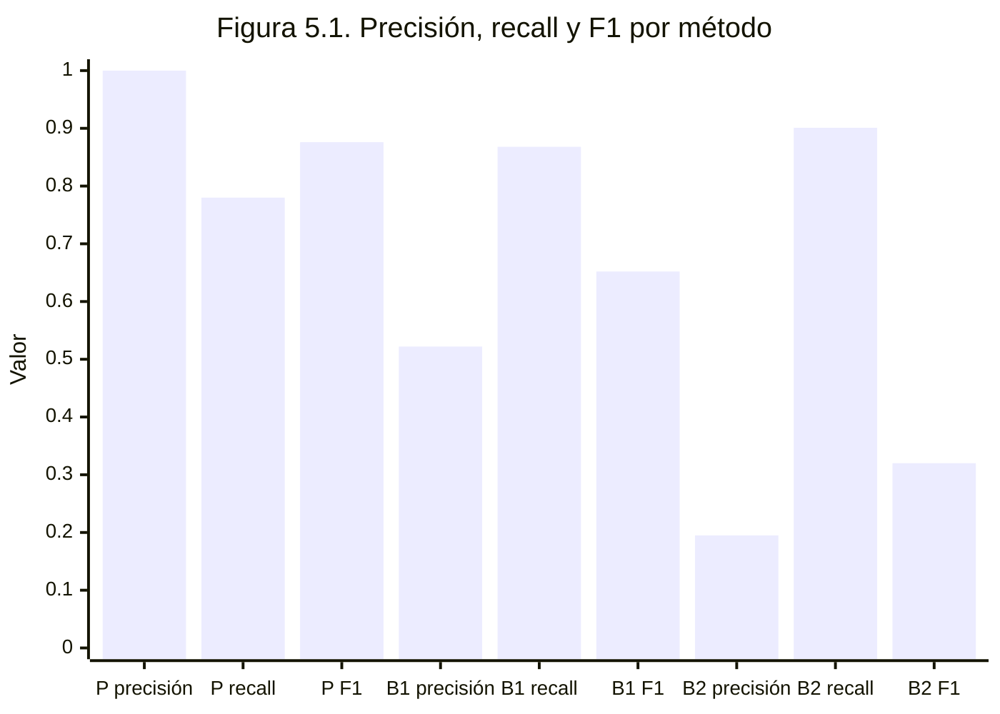

**Tabla 5.2.** Recall por tipo de relación (relaciones detectadas / verdaderas).

| Tipo de clave foránea                                             | P (`relations-v1`) | B1 (nombre) | B2 (valores) |
| ----------------------------------------------------------------- | ------------------ | ----------- | ------------ |
| Por convención (`id_cliente`, `cliente_id`, `IdCliente`…), limpia | 337/337            | 337/337     | 337/337      |
| Mismo nombre que la clave, limpia                                 | 223/223            | 223/223     | 223/223      |
| Nombre libre (`comprador`, `titular`…), limpia                    | 0/87               | 0/87        | 87/87        |
| Por convención, con un valor huérfano                             | 0/42               | 42/42       | 0/42         |
| Mismo nombre, con un valor huérfano                               | 0/21               | 21/21       | 0/21         |
| Nombre libre, con un valor huérfano                               | 0/8                | 0/8         | 0/8          |

**Tabla 5.3.** Tiempo de `relate()` (claves, relaciones, vistas y métricas) con 4 tablas: dimensión
(10 registros), entidad (500) y dos tablas de hechos con N filas cada una. 5 ejecuciones.

| Filas por tabla de hechos | Media ± DE (s) | Mediana (s) |
| ------------------------- | -------------- | ----------- |
| 1.000                     | 0,013 ± 0,001  | 0,013       |
| 10.000                    | 0,124 ± 0,038  | 0,114       |
| 100.000                   | 0,860 ± 0,047  | 0,835       |

#### 5.4.2 Recorrido automático completo (CP3, CP4)

**Tabla 5.4.** Tiempo desde la carga hasta que el progreso de todas las versiones marca `complete` (5
etapas: análisis, comprensión, investigación, dashboard e informe; la inspección corre aparte). IA
determinista. n = 5. «Etapas fallidas» cuenta las etapas en `failed` de todas las repeticiones; en la última
repetición de cada caso las 5 etapas de todas las versiones constaban como hechas.

| Caso                                      | Versiones generadas                                 | Etapas fallidas | Media ± DE (s) | IC 95 % (s)    | p50 / p90 (s) |
| ----------------------------------------- | --------------------------------------------------- | --------------- | -------------- | -------------- | ------------- |
| CP3: 1 CSV (6 registros)                  | 1                                                   | 0               | 6,97 ± 0,41    | [6,46; 7,48]   | 6,70 / 7,43   |
| CP4: 5 CSV relacionados (7.830 registros) | 8 (5 tablas + 2 vistas de hechos + 1 vista general) | 0               | 60,69 ± 1,57   | [58,74; 62,65] | 60,77 / 62,18 |

En CP4, `relations-v1` identificó las tablas de hechos (`asistencia`, `notas`), la entidad
(`estudiantes`) y las dimensiones (`carreras`, `cursos`), y abrió la vista general por estudiante con
métricas de asistencia y notas (Figura 3.3.6, captura 3).

#### 5.4.3 Escalabilidad y rendimiento de la API (CP5–CP7)

**Tabla 5.5.** Recorrido completo de un CSV de pedidos (8 columnas) según el número de filas. n = 5.

| Filas  | Tamaño | Media ± DE (s) | IC 95 % (s)    | p90 (s) | Etapas fallidas |
| ------ | ------ | -------------- | -------------- | ------- | --------------- |
| 1.000  | 51 KB  | 7,25 ± 0,05    | [7,19; 7,32]   | 7,30    | 0               |
| 10.000 | 521 KB | 10,71 ± 0,07   | [10,62; 10,79] | 10,78   | 0               |
| 50.000 | 2,6 MB | 20,85 ± 0,19   | [20,61; 21,08] | 21,03   | 0               |

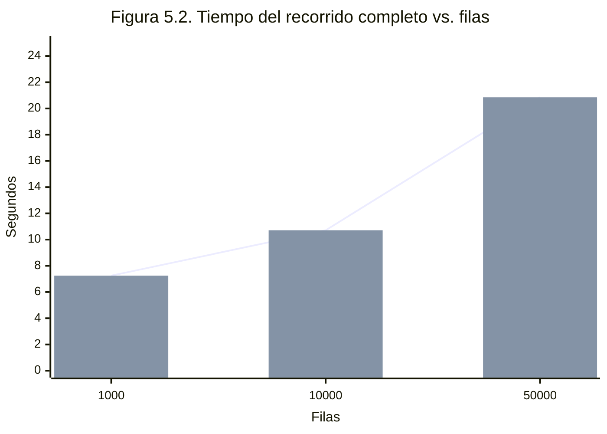

**Tabla 5.6.** Latencia de lectura (300 peticiones secuenciales por ruta, en milisegundos).

| Ruta                          | Media ± DE   | p50   | p90   | p99   | Errores |
| ----------------------------- | ------------ | ----- | ----- | ----- | ------- |
| GET /health/live              | 1,84 ± 1,98  | 1,64  | 2,01  | 2,30  | 0       |
| GET /auth/me                  | 6,96 ± 3,58  | 6,37  | 7,46  | 21,93 | 0       |
| GET /projects                 | 9,42 ± 0,88  | 9,25  | 10,15 | 13,08 | 0       |
| GET /versions/{id}/progress   | 21,34 ± 3,67 | 20,87 | 22,92 | 30,87 | 0       |
| GET /versions/{id}/preview    | 23,34 ± 1,36 | 23,29 | 24,53 | 29,19 | 0       |
| GET /versions/{id}/inspection | 40,52 ± 3,60 | 40,09 | 43,17 | 48,59 | 0       |
| GET /versions/{id}/dashboard  | 44,87 ± 5,89 | 44,09 | 47,47 | 57,26 | 0       |

**Tabla 5.7.** Throughput con concurrencia creciente (15 s por nivel; un proceso de API).

| Ruta                         | Concurrencia | req/s | p50 (ms) | p90 (ms) | p99 (ms) | Tasa de error |
| ---------------------------- | ------------ | ----- | -------- | -------- | -------- | ------------- |
| GET /projects                | 1            | 102,8 | 9,6      | 10,4     | 12,2     | 0 %           |
|                              | 5            | 216,7 | 22,6     | 25,9     | 33,4     | 0 %           |
|                              | 10           | 211,6 | 45,5     | 53,8     | 100,1    | 0 %           |
|                              | 20           | 218,0 | 88,6     | 104,7    | 156,8    | 0 %           |
| GET /versions/{id}/dashboard | 1            | 21,8  | 44,9     | 48,0     | 69,6     | 0 %           |
|                              | 5            | 43,7  | 105,7    | 162,9    | 192,3    | 0 %           |
|                              | 10           | 42,2  | 224,8    | 294,2    | 330,0    | 0 %           |
|                              | 20           | 41,4  | 438,5    | 661,7    | 738,5    | 0 %           |

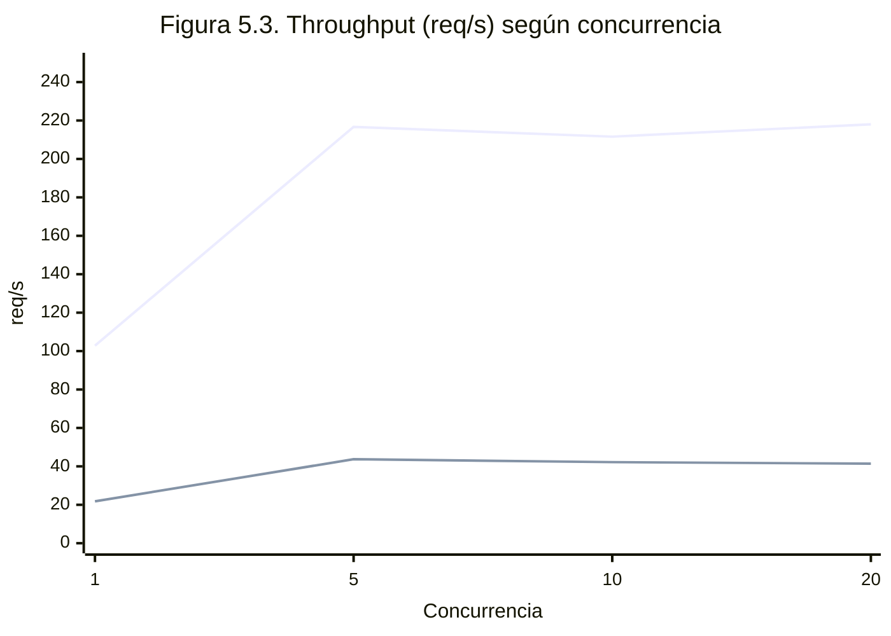

_(Línea superior: `GET /projects`; inferior: `GET /versions/{id}/dashboard`.)_ En total se atendieron
13.288 peticiones en las pruebas de throughput y 2.100 en las de latencia, sin ningún error.

#### 5.4.4 Calidad del software y cumplimiento de la arquitectura (CP8)

**Tabla 5.8.** CI de GitHub Actions sobre `main` `64a3e45` (20-11-2026). Detalle en el
[Anexo F](anexos/F-resultados-pruebas.md).

| Verificación                                                                    | Resultado                                                                               |
| ------------------------------------------------------------------------------- | --------------------------------------------------------------------------------------- |
| pytest (unitarias, integración con PostgreSQL real, migraciones, AST, _golden_) | **789 superadas, 1 omitida** (prueba con IA real, sólo con clave), 0 fallidas — 416,9 s |
| Pruebas de arquitectura por AST (`test_architecture.py`)                        | 17 reglas, todas superadas (incluidas en lo anterior)                                   |
| ruff check / ruff format                                                        | Sin incidencias / 330 archivos formateados                                              |
| mypy (`strict`)                                                                 | Sin errores en 201 archivos                                                             |
| Contrato OpenAPI y cliente regenerado                                           | Sin diferencias                                                                         |
| E2E Playwright (Chromium)                                                       | **18/18 superadas** (1,9 min)                                                           |
| Typecheck, lint y build de la web                                               | Correctos                                                                               |
| Imágenes de producción (GHCR)                                                   | Compiladas y publicadas                                                                 |

#### 5.4.5 Comportamiento con la IA real (CP9)

Registro `copilot_ai_calls` de las pruebas manuales con Claude (`claude-opus-5-5`, esfuerzo `low`) del
20-11-2026 en el equipo de desarrollo: 6 proyectos, 16 versiones analizadas con IA.

**Tabla 5.9.** Llamadas reales a la IA por tarea.

| Tarea                      | Llamadas | Aceptadas       | Latencia media de las aceptadas (s) | p90 de las aceptadas (s) | Tokens entrada / salida (media, aceptadas) | Coste (USD) |
| -------------------------- | -------- | --------------- | ----------------------------------- | ------------------------ | ------------------------------------------ | ----------- |
| Comprensión del negocio    | 17       | 17              | 11,8                                | 15,9                     | 848 / 1.396                                | 0,592       |
| Propuesta de investigación | 16       | 15              | 12,5                                | 16,2                     | 1.619 / 1.408                              | 0,552       |
| Juicio de relevancia       | 27       | 26              | 8,8                                 | 11,9                     | 6.140 / 912                                | 1,169       |
| Diseño del dashboard       | 5        | 5               | 6,7                                 | 10,7                     | 1.699 / 668                                | 0,117       |
| Narrativa del informe      | 4        | 4               | 9,7                                 | 10,3                     | 732 / 903                                  | 0,089       |
| **Total**                  | **69**   | **67 (97,1 %)** | **10,3** (p50 10,8)                 | **15,5**                 | —                                          | **2,518**   |

Latencias de las 67 llamadas aceptadas; con las 2 fallidas (≈ 30 s cada una), la media global es 10,9 s
y el p90 16,0 s. Datos en bruto: `bench/ai_calls_2026-11-20.json`. Las 2 llamadas no aceptadas fueron errores del proveedor por tiempo agotado (~30 s); en ambos casos el
sistema continuó sin el texto de la IA, sin fallar la etapa. Con la IA real, el tiempo desde la carga hasta
el informe fue, **por versión** (n = 16), de **273,1 ± 119,2 s** (p50 281,4 s; p90 383,9 s), incluyendo la espera
en cola de las versiones de un mismo conjunto (como mucho 3 trabajos en marcha por cuenta).

### 5.5 Comparación con línea base y estado del arte

**Tabla 5.10.** Detección de relaciones entre tablas.

| Método                                           | Precisión | Recall | F1        | Fuente                                                            |
| ------------------------------------------------ | --------- | ------ | --------- | ----------------------------------------------------------------- |
| **`relations-v1` (propuesto)**                   | **1,000** | 0,780  | **0,876** | Este trabajo (200 esquemas sintéticos)                            |
| Sólo nombre (B1)                                 | 0,522     | 0,868  | 0,652     | Este trabajo, misma verdad de referencia                          |
| Dependencias de inclusión (B2), criterio de [13] | 0,195     | 0,901  | 0,320     | Este trabajo, misma verdad de referencia                          |
| Auto-BI (k-MCA)                                  | —         | —      | > 0,9     | [29] (benchmarks BI reales y TPC; **no comparable directamente**) |

**Tabla 5.11.** Fiabilidad de las cifras producidas.

| Enfoque                                                                               | Quién calcula las cifras                               | Exactitud reportada                                                                                                                 | Fuente       |
| ------------------------------------------------------------------------------------- | ------------------------------------------------------ | ----------------------------------------------------------------------------------------------------------------------------------- | ------------ |
| **DataFlow AI**                                                                       | Motor determinista; el LLM sólo cita `{{evidence:id}}` | Cifras exactas sobre todo el dataset (pruebas _golden_); ninguna cifra del modelo llega a la interfaz sin pasar por la verificación | Este trabajo |
| GPT-4 en texto a SQL (BIRD)                                                           | LLM genera SQL                                         | 54,89 % de exactitud de ejecución (humano 92,96 %)                                                                                  | [38]         |
| DAIL-SQL (Spider)                                                                     | LLM genera SQL                                         | 86,6 % de exactitud de ejecución                                                                                                    | [41]         |
| Verificación de afirmaciones numéricas (QuanTemp)                                     | Modelos NLI                                            | 58,32 macro-F1 (mejor línea base)                                                                                                   | [45]         |
| Hallazgos de usuarios en herramientas visuales sin control de comparaciones múltiples | Usuario                                                | > 60 % de hallazgos falsos                                                                                                          | [9]          |

La Tabla 5.11 no compara métricas idénticas: muestra que los enfoques que dejan el cálculo al LLM tienen
una tasa de error de entre el 13 % y el 45 % en sus propios benchmarks, mientras que en DataFlow AI esa
fuente de error está excluida por construcción.

### 5.6 Análisis estadístico

- **Diferencia entre `relations-v1` y las líneas base (prueba de McNemar con corrección de continuidad,
  sobre 3.962 pares columna→tabla de la unión de verdad y predicciones).** Frente a B1: el método propuesto
  acierta en 570 pares en los que B1 falla y B1 acierta en 63 en los que el propuesto falla;
  $\chi^2(1) = 404{,}48$, $p = 5{,}8 \times 10^{-90}$; razón de discordantes 9,05. Frente a B2: 2.674 frente
  a 87; $\chi^2(1) = 2.422{,}09$, $p < 10^{-300}$; razón 30,7. Las diferencias son significativas y de
  gran tamaño.
- **Intervalos de confianza del F1** (_bootstrap_ de esquemas, 2.000 remuestreos): los IC 95 % no se
  solapan (P [0,859; 0,894], B1 [0,634; 0,672], B2 [0,306; 0,336]).
- **Efecto del tamaño del archivo en el tiempo del recorrido (Kruskal-Wallis, 3 grupos × 5):**
  $H(2) = 12{,}50$, $p = 0{,}0019$, $\varepsilon^2 = 0{,}893$ (efecto grande). El tiempo crece con las filas,
  pero de forma sublineal: ×50 filas → ×2,9 tiempo (de 7,25 a 20,85 s).
- **Medias con IC 95 %** (t de Student, gl = 4) en las Tablas 5.4 y 5.5; las desviaciones son menores del
  3 % de la media en todos los casos salvo CP3 (5,9 %), lo que indica tiempos estables.

### 5.7 Discusión de resultados

- **Relaciones: precisión perfecta a cambio de exhaustividad.** `relations-v1` no produjo ningún falso
  positivo en 200 esquemas, mientras que B1 confundió columnas del mismo nombre que no son claves pero cuyos valores resultan únicos
  en dos tablas (`monto` 370 veces, `nombre` 200) y B2 unió columnas numéricas cuyos valores caben por azar
  en un rango de claves (`cantidad` 1–10 y `edad` 18–70 frente a identificadores que empiezan en 1: 848 y
  623 falsos positivos) o claves de una tabla con las de otra. Es la consecuencia directa de exigir a la
  vez nombre y contención total: se acepta perder relaciones antes que unir tablas que no se corresponden,
  coherente con el principio «ante la duda, no se transforma».
- **Dónde falla.** El recall de 0,780 se explica entero por dos casos de la Tabla 5.2: (a) claves foráneas
  con **nombre libre** (`comprador` → `clientes.id`), que sólo B2 detecta pero a costa de 2.674 falsos
  positivos; y (b) relaciones con **valores huérfanos**: una sola fila sin pareja hace que la regla no una
  las tablas. Ambos son límites deliberados del diseño y se explican al usuario con su motivo, pero en datos
  reales poco limpios reducirán el número de vistas unidas. Las claves foráneas **declaradas** por una base
  de datos no tienen el problema (a), porque entran sin depender del nombre.
- **Recorrido completo.** Las 25 cargas evaluadas (CP3–CP5) y sus 60 versiones terminaron el recorrido con 0 etapas
  fallidas y sin intervención. El tiempo está dominado por costes fijos (arranque del subproceso aislado,
  publicación y encadenamiento de seis trabajos), por eso un CSV de 6 filas tarda 7 s y uno de 50.000 sólo
  21 s. Cinco archivos relacionados tardan unos 61 s porque generan 8 versiones, cada una con su recorrido
  completo, procesadas con un solo worker.
- **API.** Todas las lecturas tienen p90 < 50 ms en secuencia, muy por debajo del objetivo de 500 ms.
  Con concurrencia, `GET /projects` se satura en torno a 217 req/s desde 5 clientes, y el dashboard
  (que construye un documento JSON grande) en torno a 42 req/s; con 20 clientes simultáneos su p90 sube a
  662 ms, por encima del objetivo: es el punto débil si muchos usuarios consultan dashboards a la vez con un
  único proceso de API, y se resolvería con varios procesos de uvicorn o caché del documento publicado
  (que es inmutable).
- **Calidad semántica sin IA.** Sin los significados que aporta la IA, las reglas pueden elegir
  análisis poco útiles: en la vista general de `examples/relacionadas` con el proveedor de pruebas, el plan
  incluyó «evolución mensual de la suma de `costo_semestre`» por mes de `fecha_ingreso` (captura 7), una
  métrica sin sentido de negocio, aunque calculada correctamente y marcada sólo como hallazgo secundario.
  Es un límite del criterio por reglas, no del cálculo.
- **IA real.** La IA domina el tiempo total (≈ 10 s por llamada, varias llamadas por versión): con IA real
  el recorrido pasa de segundos a unos 4–6 minutos por versión (p50 281 s, p90 384 s). El 97,1 % de las llamadas se aceptó y los
  fallos del proveedor no rompieron el recorrido, lo que valida el diseño de degradación sin IA.

---

## Sección 6 — Discusión integradora

### 6.1 Respuesta a la pregunta de investigación

La separación entre un motor determinista que calcula y una IA que sólo explica y propone **permite**
obtener, sin intervención del usuario, un análisis completo y trazable en tiempo aceptable:

- **Sin intervención**: las 25 cargas evaluadas (1 archivo, 5 archivos relacionados y CSV de hasta 50.000
  filas) llegaron solas hasta el informe, con 0 etapas fallidas (§5.4.2–5.4.3).
- **Correcto y trazable**: las cifras las calcula el motor sobre todo el dataset y la IA sólo puede
  citarlas por evidencia; la batería de 789 pruebas (incluidas las _golden_ y las 17 reglas AST) lo
  verifica en cada cambio (§5.4.4). En la parte más expuesta a error, unir tablas, la regla propuesta
  alcanzó precisión 1,000, significativamente mejor que las alternativas ($p < 10^{-89}$) (§5.4.1).
- **En tiempo aceptable**: 7–21 s por archivo sin IA y unos 4–6 min por versión con IA real en un PC de
  escritorio; lecturas de la API con p90 < 50 ms.

La medida en que lo logra está acotada por el recall de la detección de relaciones (0,780 en el benchmark),
por la latencia del proveedor de IA y por la ausencia de una evaluación con usuarios.

### 6.2 Contribuciones técnicas verificadas

| Contribución                                                              | Evidencia                                                                                                                                                                |
| ------------------------------------------------------------------------- | ------------------------------------------------------------------------------------------------------------------------------------------------------------------------ |
| Arquitectura «la IA explica, el motor calcula» verificada automáticamente | 17 reglas AST y pruebas de verificación de cifras en la CI (Tabla 5.8); 97,1 % de respuestas reales aceptadas sin que un fallo de la IA detenga el recorrido (Tabla 5.9) |
| Modelo de varias tablas sin intervención (`relations-v1`)                 | Precisión 1,000 y F1 0,876 frente a 0,652 y 0,320; McNemar $p < 10^{-89}$ (Tablas 5.1, 5.10)                                                                             |
| Recorrido automático completo de archivo o conjunto relacionado a informe | 25 cargas, 60 versiones, 0 etapas fallidas (Tablas 5.4, 5.5)                                                                                                             |
| Investigación estadística con control de falsos descubrimientos           | Implementación de chi², Kruskal-Wallis y Benjamini-Hochberg cubierta por pruebas (fragmento 4, §4.2)                                                                     |
| Trazabilidad e inmutabilidad                                              | 35 tablas con trigger de inmutabilidad, `effect_sha256`, migraciones con prueba de ida y vuelta (Anexo C)                                                                |

### 6.3 Limitaciones del trabajo

1. **Sin evaluación con usuarios.** No se midió la usabilidad (SUS) ni la comprensión de los resultados por
   personas no analistas; la afirmación de que la interfaz «se entiende sin leer» no está validada
   empíricamente.
2. **Datos sintéticos.** Todas las mediciones usan datos generados; los datos reales tienen más ruido,
   nombres libres y valores huérfanos, que reducen el recall de `relations-v1`.
3. **Relaciones limitadas por diseño**: sólo claves de una columna, sin claves compuestas ni muchos a muchos;
   la unión compara el texto exacto (`001` ≠ `1`); vistas a dos pasos como mucho; la vista general sólo
   resume con registros, promedios y porcentajes.
4. **Sin modelos predictivos**: el análisis es descriptivo e inferencial (pruebas de asociación); no se
   pronostica ni se estiman efectos causales; la estandarización usa una sola variable de control.
5. **Estadística con muestras pequeñas**: con pocos registros por grupo casi todo resulta «no concluyente»
   (mínimo de 10 por grupo); chi² no aplica corrección para frecuencias esperadas bajas.
6. **Dependencia de un proveedor de IA** externo con latencia de ~10 s por llamada, coste por uso y
   presupuesto: al agotarse, el análisis puede esperar hasta el día o el mes siguiente.
7. **Escala de un solo servidor**: un único worker en la evaluación y un único servidor en producción; los
   archivos viven en un volumen local (crecer en horizontal exige almacenamiento de objetos); el dashboard
   supera 500 ms de p90 con 20 clientes simultáneos; una copia de base en curso se pierde si la API se
   reinicia.
8. **Límites de entrada**: 5 MB por archivo, 100.000 filas, 128 columnas; `.xls` antiguo no admitido.
9. **Seguridad de cuentas**: registro abierto sin verificación de correo ni recuperación de contraseña.
10. **Despliegue automático no ejercitado**: en la CI de `64a3e45` las imágenes se publicaron en GHCR, pero
    el paso de despliegue por SSH quedó omitido porque el entorno `production` no tenía servidor
    configurado.

### 6.4 Amenazas a la validez

- **Validez interna.** Las mediciones se hicieron en el mismo equipo que la base de datos y el cliente
  (sin red), con un solo worker y con otros procesos del sistema operativo en marcha; se mitigó repitiendo
  5 veces y reportando la dispersión (DE ≤ 6 % de la media). El proveedor de IA determinista elimina la
  variabilidad del LLM pero subestima el tiempo real, que se reporta aparte con datos reales. El generador
  de esquemas lo escribieron los mismos autores que la regla, lo que puede favorecerla; se mitigó
  incluyendo a propósito casos que la regla no cubre (nombres libres, huérfanos) y publicando el
  generador.
- **Validez externa.** Los resultados se obtuvieron con datos sintéticos de tres dominios (ventas,
  académico, esquemas genéricos) y en un PC de escritorio con Windows; no se pueden generalizar sin más a
  datos reales de otros dominios ni al servidor Linux de producción. Las 69 llamadas reales a la IA
  provienen de un solo día y un solo modelo.
- **Validez de constructo.** «Análisis correcto» se operacionalizó como cifras exactas (pruebas _golden_),
  etapas sin fallos y relaciones correctas; no mide si los hallazgos son útiles o se interpretan bien. La
  verificación de cifras garantiza que los números vienen del motor, no que la prosa de la IA sea
  semánticamente correcta.
- **Validez estadística.** n = 5 por condición en los tiempos limita la potencia (por eso se usa
  Kruskal-Wallis y se reporta el tamaño del efecto); la prueba de McNemar se aplica a pares que no son
  totalmente independientes (varios pares por esquema), por lo que se complementa con el _bootstrap_ por
  esquemas, que respeta esa agrupación.

### 6.5 Trabajo futuro

1. **Evaluación con usuarios** según el protocolo del Anexo G (N ≥ 12, SUS, éxito y tiempo por tarea) y un
   estudio comparativo frente a una hoja de cálculo, para validar la usabilidad y la comprensión de los
   hallazgos.
2. **Relaciones más robustas sin perder precisión**: aceptar un porcentaje acotado de huérfanos con aviso
   explícito y vistas que conserven los registros sin pareja; claves compuestas; y una propuesta de la IA
   para nombres libres que el motor confirme por contención (la IA propone, el motor valida). Evaluarlo
   sobre esquemas reales públicos (p. ej. bases de ejemplo como Pagila).
3. **Escalado horizontal**: almacenamiento de objetos compatible con S3, varios workers y procesos de API,
   y caché del dashboard publicado (inmutable) para mantener p90 < 500 ms con decenas de usuarios.
4. **Menor dependencia de la IA**: caché de respuestas por hash del contexto, llamadas en paralelo dentro
   de una versión y un modelo local opcional para explicar sin coste por uso.
5. **Más análisis con el mismo principio**: series temporales con pronóstico y modelos de regresión como
   operaciones versionadas del motor, con intervalos de confianza y explicación por evidencia.

---

## Sección 7 — Conclusiones

- **Solución.** Se desarrolló DataFlow AI, una plataforma web que analiza de forma completamente
  automática un archivo CSV/Excel, de 2 a 5 archivos relacionados o un esquema de PostgreSQL/SQL Server:
  lee, inspecciona, limpia de forma segura, relaciona tablas, comprende el negocio, investiga con pruebas
  estadísticas corregidas por comparaciones múltiples, publica un dashboard y redacta un informe PDF. Un
  motor determinista (Python/Polars) calcula todas las cifras y un LLM (Claude) sólo explica y propone en
  esquemas cerrados que Python valida. El sistema tiene 20 módulos, 66 rutas, 57 tablas, 30 migraciones y
  44 decisiones de arquitectura documentadas, construidos en 33 fases y 43 PR.
- **Resultados clave.**
  - Detección de relaciones: **precisión 1,000, recall 0,780 y F1 0,876** [0,859; 0,894], frente a F1 0,652
    (sólo nombre) y 0,320 (sólo valores); McNemar $p = 5{,}8 \times 10^{-90}$ y $p < 10^{-300}$.
  - Recorrido completo sin IA: **6,97 ± 0,41 s** (1 CSV), **60,69 ± 1,57 s** (5 archivos, 8 versiones) y
    **20,85 ± 0,19 s** con 50.000 filas; **0 etapas fallidas** en 25 cargas (60 versiones).
  - API: p90 de lectura entre **2,0 y 47,5 ms**; hasta **218 req/s** con **0 % de errores** en 15.388
    peticiones.
  - IA real: **97,1 %** de 69 llamadas aceptadas, 10,3 s de latencia media de las aceptadas y 2,52 USD en total.
  - Calidad: **789 pruebas** del backend y **18 E2E** en verde en la CI; mypy _strict_ sin errores.
- **Impacto potencial.** Permite a organizaciones sin analistas obtener un análisis estadísticamente
  controlado y trazable de sus propios datos —incluidos varios archivos relacionados o su base de datos— en
  minutos y sin configurar nada, reduciendo los riesgos documentados de los análisis exploratorios sin
  control (más del 60 % de hallazgos falsos [9]) y de las cifras calculadas por LLM [38], [45].
- **Reproducibilidad.** El código está en GitHub con instrucciones completas (Anexo D), versiones fijadas
  (`requirements.lock`, `package-lock.json`), contratos regenerados por script y CI pública del
  repositorio. Los datos de evaluación son sintéticos y se generan con semilla fija; los scripts y
  resultados en bruto están en `docs/tddr/bench/`. El repositorio es privado: el acceso se concede a
  solicitud.

---

## Sección 8 — Referencias

Formato IEEE. 51 referencias verificadas por DOI (Crossref) o en la página del editor; 37 de 51
(**72,5 %**) de 2021–2026; 35 de 51 (**68,6 %**) en revistas Q1 (SJR 2024) o congresos A\* (CORE2023)
verificados; ninguna de blogs, Wikipedia ni arXiv. Verificación detallada en el
[Anexo H](anexos/H-verificacion-referencias.md). Se mantiene la numeración de la revisión de literatura.

[1] Y. Benjamini and Y. Hochberg, "Controlling the false discovery rate: A practical and powerful approach to multiple testing," _J. Roy. Statist. Soc. Ser. B (Methodol.)_, vol. 57, no. 1, pp. 289–300, 1995, doi: 10.1111/j.2517-6161.1995.tb02031.x.

[2] W. H. Kruskal and W. A. Wallis, "Use of ranks in one-criterion variance analysis," _J. Amer. Statist. Assoc._, vol. 47, no. 260, pp. 583–621, 1952, doi: 10.1080/01621459.1952.10483441.

[3] K. Pearson, "On the criterion that a given system of deviations from the probable in the case of a correlated system of variables is such that it can be reasonably supposed to have arisen from random sampling," _London, Edinburgh, Dublin Philos. Mag. J. Sci._, vol. 50, no. 302, pp. 157–175, 1900, doi: 10.1080/14786440009463897.

[4] J. Brooke, "SUS: A 'quick and dirty' usability scale," in _Usability Evaluation in Industry_, P. W. Jordan, B. Thomas, I. L. McClelland, and B. Weerdmeester, Eds. CRC Press, 1996, pp. 207–212, doi: 10.1201/9781498710411-35.

[5] _Systems and Software Engineering — Systems and Software Quality Requirements and Evaluation (SQuaRE) — Product Quality Model_, ISO/IEC 25010:2023, 2023. [Online]. Available: https://www.iso.org/standard/78176.html

[6] M. Herschel, R. Diestelkämper, and H. Ben Lahmar, "A survey on provenance: What for? What form? What from?," _VLDB J._, vol. 26, no. 6, pp. 881–906, 2017, doi: 10.1007/s00778-017-0486-1.

[7] S. Schelter, D. Lange, P. Schmidt, M. Celikel, F. Biessmann, and A. Grafberger, "Automating large-scale data quality verification," _Proc. VLDB Endow._, vol. 11, no. 12, pp. 1781–1794, 2018, doi: 10.14778/3229863.3229867.

[8] Z. Zhao, L. De Stefani, E. Zgraggen, C. Binnig, E. Upfal, and T. Kraska, "Controlling false discoveries during interactive data exploration," in _Proc. ACM SIGMOD Int. Conf. Manage. Data_, 2017, pp. 527–540, doi: 10.1145/3035918.3064019.

[9] E. Zgraggen, Z. Zhao, R. Zeleznik, and T. Kraska, "Investigating the effect of the multiple comparisons problem in visual analysis," in _Proc. CHI Conf. Human Factors Comput. Syst._, 2018, pp. 1–12, doi: 10.1145/3173574.3174053.

[10] S. Jo, I. Trummer, W. Yu, X. Wang, C. Yu, D. Liu, and N. Mehta, "Verifying text summaries of relational data sets," in _Proc. ACM SIGMOD Int. Conf. Manage. Data_, 2019, pp. 299–316, doi: 10.1145/3299869.3300074.

[11] R. Ding, S. Han, Y. Xu, H. Zhang, and D. Zhang, "QuickInsights: Quick and automatic discovery of insights from multi-dimensional data," in _Proc. ACM SIGMOD Int. Conf. Manage. Data_, 2019, pp. 317–332, doi: 10.1145/3299869.3314037.

[12] M. Vartak, S. Rahman, S. Madden, A. Parameswaran, and N. Polyzotis, "SeeDB: Efficient data-driven visualization recommendations to support visual analytics," _Proc. VLDB Endow._, vol. 8, no. 13, pp. 2182–2193, 2015, doi: 10.14778/2831360.2831371.

[13] L. Jiang and F. Naumann, "Holistic primary key and foreign key detection," _J. Intell. Inf. Syst._, vol. 54, no. 3, pp. 439–461, 2020, doi: 10.1007/s10844-019-00562-z.

[14] G. J. J. van den Burg, A. Nazábal, and C. Sutton, "Wrangling messy CSV files by detecting row and type patterns," _Data Min. Knowl. Discov._, vol. 33, no. 6, pp. 1799–1820, 2019, doi: 10.1007/s10618-019-00646-y.

[15] D. J.-L. Lee _et al._, "Lux: Always-on visualization recommendations for exploratory dataframe workflows," _Proc. VLDB Endow._, vol. 15, no. 3, pp. 727–738, 2021, doi: 10.14778/3494124.3494151.

[16] J. Peng _et al._, "DataPrep.EDA: Task-centric exploratory data analysis for statistical modeling in Python," in _Proc. Int. Conf. Manage. Data (SIGMOD)_, 2021, pp. 2271–2280, doi: 10.1145/3448016.3457330.

[17] P. Ma, R. Ding, S. Han, and D. Zhang, "MetaInsight: Automatic discovery of structured knowledge for exploratory data analysis," in _Proc. Int. Conf. Manage. Data (SIGMOD)_, 2021, pp. 1262–1274, doi: 10.1145/3448016.3457267.

[18] J. Song and Y. He, "Auto-Validate: Unsupervised data validation using data-domain patterns inferred from data lakes," in _Proc. Int. Conf. Manage. Data (SIGMOD)_, 2021, pp. 1678–1691, doi: 10.1145/3448016.3457250.

[19] C. Koutras _et al._, "Valentine: Evaluating matching techniques for dataset discovery," in _Proc. IEEE 37th Int. Conf. Data Eng. (ICDE)_, 2021, pp. 468–479, doi: 10.1109/ICDE51399.2021.00047.

[20] D. Shi, X. Xu, F. Sun, Y. Shi, and N. Cao, "Calliope: Automatic visual data story generation from a spreadsheet," _IEEE Trans. Vis. Comput. Graphics_, vol. 27, no. 2, pp. 453–463, 2021, doi: 10.1109/TVCG.2020.3030403.

[21] A. Narechania, A. Srinivasan, and J. Stasko, "NL4DV: A toolkit for generating analytic specifications for data visualization from natural language queries," _IEEE Trans. Vis. Comput. Graphics_, vol. 27, no. 2, pp. 369–379, 2021, doi: 10.1109/TVCG.2020.3030378.

[22] X. He, K. Zhao, and X. Chu, "AutoML: A survey of the state-of-the-art," _Knowl.-Based Syst._, vol. 212, Art. no. 106622, 2021, doi: 10.1016/j.knosys.2020.106622.

[23] S. K. Karmaker ("Santu"), M. M. Hassan, M. J. Smith, L. Xu, C. Zhai, and K. Veeramachaneni, "AutoML to date and beyond: Challenges and opportunities," _ACM Comput. Surv._, vol. 54, no. 8, pp. 1–36, 2022, doi: 10.1145/3470918.

[24] T. De Bie, L. De Raedt, J. Hernández-Orallo, H. H. Hoos, P. Smyth, and C. K. I. Williams, "Automating data science," _Commun. ACM_, vol. 65, no. 3, pp. 76–87, 2022, doi: 10.1145/3495256.

[25] A. Wu _et al._, "AI4VIS: Survey on artificial intelligence approaches for data visualization," _IEEE Trans. Vis. Comput. Graphics_, vol. 28, no. 12, pp. 5049–5070, 2022, doi: 10.1109/TVCG.2021.3099002.

[26] H. Li, Y. Wang, S. Zhang, Y. Song, and H. Qu, "KG4Vis: A knowledge graph-based approach for visualization recommendation," _IEEE Trans. Vis. Comput. Graphics_, vol. 28, no. 1, pp. 195–205, 2022, doi: 10.1109/TVCG.2021.3114863.

[27] Y. Luo, N. Tang, G. Li, J. Tang, C. Chai, and X. Qin, "Natural language to visualization by neural machine translation," _IEEE Trans. Vis. Comput. Graphics_, vol. 28, no. 1, pp. 217–226, 2022, doi: 10.1109/TVCG.2021.3114848.

[28] L. Ehrlinger and W. Wöß, "A survey of data quality measurement and monitoring tools," _Front. Big Data_, vol. 5, Art. no. 850611, 2022, doi: 10.3389/fdata.2022.850611.

[29] Y. Lin, Y. He, and S. Chaudhuri, "Auto-BI: Automatically build BI-models leveraging local join prediction and global schema graph," _Proc. VLDB Endow._, vol. 16, no. 10, pp. 2578–2590, 2023, doi: 10.14778/3603581.3603596.

[30] Y. Dong, C. Xiao, T. Nozawa, M. Enomoto, and M. Oyamada, "DeepJoin: Joinable table discovery with pre-trained language models," _Proc. VLDB Endow._, vol. 16, no. 10, pp. 2458–2470, 2023, doi: 10.14778/3603581.3603587.

[31] G. Fan, J. Wang, Y. Li, D. Zhang, and R. J. Miller, "Semantics-aware dataset discovery from data lakes with contextualized column-based representation learning," _Proc. VLDB Endow._, vol. 16, no. 7, pp. 1726–1739, 2023, doi: 10.14778/3587136.3587146.

[32] G. Vitagliano, M. Hameed, L. Jiang, L. Reisener, E. Wu, and F. Naumann, "Pollock: A data loading benchmark," _Proc. VLDB Endow._, vol. 16, no. 8, pp. 1870–1882, 2023, doi: 10.14778/3594512.3594518.

[33] P. Li, Y. He, C. Yan, Y. Wang, and S. Chaudhuri, "Auto-Tables: Synthesizing multi-step transformations to relationalize tables without using examples," _Proc. VLDB Endow._, vol. 16, no. 11, pp. 3391–3403, 2023, doi: 10.14778/3611479.3611534.

[34] Y. Zhang, A. Floratou, J. Cahoon, S. Krishnan, A. C. Müller, D. Banda, F. Psallidas, and J. M. Patel, "Schema matching using pre-trained language models," in _Proc. IEEE 39th Int. Conf. Data Eng. (ICDE)_, 2023, pp. 1558–1571, doi: 10.1109/ICDE55515.2023.00123.

[35] V. Dibia, "LIDA: A tool for automatic generation of grammar-agnostic visualizations and infographics using large language models," in _Proc. 61st Annu. Meeting Assoc. Comput. Linguistics (Vol. 3: System Demonstrations)_, 2023, pp. 113–126, doi: 10.18653/v1/2023.acl-demo.11.

[36] P. Maddigan and T. Susnjak, "Chat2VIS: Generating data visualizations via natural language using ChatGPT, Codex and GPT-3 large language models," _IEEE Access_, vol. 11, pp. 45181–45193, 2023, doi: 10.1109/ACCESS.2023.3274199.

[37] L. Cheng, X. Li, and L. Bing, "Is GPT-4 a good data analyst?," in _Findings Assoc. Comput. Linguistics: EMNLP 2023_, 2023, pp. 9496–9514, doi: 10.18653/v1/2023.findings-emnlp.637.

[38] J. Li _et al._, "Can LLM already serve as a database interface? A BIg bench for large-scale database grounded text-to-SQLs," in _Adv. Neural Inf. Process. Syst. (NeurIPS), Datasets and Benchmarks Track_, vol. 36, 2023, pp. 42330–42357, doi: 10.52202/075280-1835. [Online]. Available: https://proceedings.neurips.cc/paper_files/paper/2023/hash/83fc8fab1710363050bbd1d4b8cc0021-Abstract-Datasets_and_Benchmarks.html

[39] Z. Ji _et al._, "Survey of hallucination in natural language generation," _ACM Comput. Surv._, vol. 55, no. 12, pp. 1–38, 2023, doi: 10.1145/3571730.

[40] C. Wang, J. Thompson, and B. Lee, "Data Formulator: AI-powered concept-driven visualization authoring," _IEEE Trans. Vis. Comput. Graphics_, 2023 (early access, pp. 1–11), doi: 10.1109/TVCG.2023.3326585.

[41] D. Gao _et al._, "Text-to-SQL empowered by large language models: A benchmark evaluation," _Proc. VLDB Endow._, vol. 17, no. 5, pp. 1132–1145, 2024, doi: 10.14778/3641204.3641221.

[42] P. Li _et al._, "Table-GPT: Table fine-tuned GPT for diverse table tasks," _Proc. ACM Manage. Data_, vol. 2, no. 3, pp. 1–28, 2024, doi: 10.1145/3654979.

[43] K. Gu, R. Shang, T. Althoff, C. Wang, and S. M. Drucker, "How do analysts understand and verify AI-assisted data analyses?," in _Proc. CHI Conf. Human Factors Comput. Syst._, 2024, pp. 1–22, doi: 10.1145/3613904.3642497.

[44] M. Kazemitabaar _et al._, "Improving steering and verification in AI-assisted data analysis with interactive task decomposition," in _Proc. 37th Annu. ACM Symp. User Interface Softw. Technol. (UIST)_, 2024, pp. 1–19, doi: 10.1145/3654777.3676345.

[45] V. Venktesh, A. Anand, A. Anand, and V. Setty, "QuanTemp: A real-world open-domain benchmark for fact-checking numerical claims," in _Proc. 47th Int. ACM SIGIR Conf. Res. Develop. Inf. Retrieval_, 2024, pp. 650–660, doi: 10.1145/3626772.3657874.

[46] M. S. Islam, M. T. R. Laskar, M. R. Parvez, E. Hoque, and S. Joty, "DataNarrative: Automated data-driven storytelling with visualizations and texts," in _Proc. Conf. Empirical Methods Natural Lang. Process. (EMNLP)_, 2024, pp. 19253–19286, doi: 10.18653/v1/2024.emnlp-main.1073.

[47] Q. Chen, S. Cao, J. Wang, and N. Cao, "How does automation shape the process of narrative visualization: A survey of tools," _IEEE Trans. Vis. Comput. Graphics_, vol. 30, no. 8, pp. 4429–4448, 2024, doi: 10.1109/TVCG.2023.3261320.

[48] Y. Liu, E. H. M. Pena, A. Santos, E. Wu, and J. Freire, "Magneto: Combining small and large language models for schema matching," _Proc. VLDB Endow._, vol. 18, no. 8, pp. 2681–2694, 2025, doi: 10.14778/3742728.3742757.

[49] Z. Hong _et al._, "Next-generation database interfaces: A survey of LLM-based text-to-SQL," _IEEE Trans. Knowl. Data Eng._, vol. 37, no. 12, pp. 7328–7345, 2025, doi: 10.1109/TKDE.2025.3609486.

[50] L. Huang _et al._, "A survey on hallucination in large language models: Principles, taxonomy, challenges, and open questions," _ACM Trans. Inf. Syst._, vol. 43, no. 2, pp. 1–55, 2025, doi: 10.1145/3703155.

[51] K. Hu, M. A. Bakker, S. Li, T. Kraska, and C. Hidalgo, "VizML: A machine learning approach to visualization recommendation," in _Proc. CHI Conf. Human Factors Comput. Syst._, 2019, pp. 1–12, doi: 10.1145/3290605.3300358.

---

## Sección 9 — Anexos técnicos

| Anexo | Contenido                                                                                                       | Archivo                                                                          |
| ----- | --------------------------------------------------------------------------------------------------------------- | -------------------------------------------------------------------------------- |
| A     | Diagrama de arquitectura completo (despliegue, módulos y dependencias reales, capas, trabajos de fondo)         | [anexos/A-arquitectura.md](anexos/A-arquitectura.md)                             |
| B     | Especificación de la API (69 operaciones, convenciones, ejemplo, errores estables) + contrato OpenAPI normativo | [anexos/B-api.md](anexos/B-api.md), `contracts/openapi/dataflow.json`            |
| C     | Diccionario de datos y esquema de base de datos (57 tablas, 30 migraciones, inmutabilidad)                      | [anexos/C-base-de-datos.md](anexos/C-base-de-datos.md)                           |
| D     | Manual de instalación y reproducibilidad (incluye cómo repetir cada medición)                                   | [anexos/D-instalacion.md](anexos/D-instalacion.md)                               |
| E     | Datasets: descripción, estadísticas descriptivas y acceso                                                       | [anexos/E-datasets.md](anexos/E-datasets.md)                                     |
| F     | Resultados completos de pruebas, incluidos los negativos                                                        | [anexos/F-resultados-pruebas.md](anexos/F-resultados-pruebas.md), `bench/*.json` |
| G     | Consentimiento informado y protocolo SUS (plantilla: no hubo participantes)                                     | [anexos/G-consentimiento-y-sus.md](anexos/G-consentimiento-y-sus.md)             |
| H     | Revisión de literatura y verificación de cada referencia (venue, nivel, DOI)                                    | [anexos/H-verificacion-referencias.md](anexos/H-verificacion-referencias.md)     |

Figuras de pantallas: `docs/tddr/img/`. Scripts y resultados en bruto: `docs/tddr/bench/`.

---

## Autoevaluación con la rúbrica

| Criterio                            | Nivel                  | Justificación                                                                                                                                                                         |
| ----------------------------------- | ---------------------- | ------------------------------------------------------------------------------------------------------------------------------------------------------------------------------------- |
| Problema con evidencia cuantitativa | Sólido (2)             | Cifras con fuente primaria revisada por pares: > 60 % de hallazgos falsos [9], 54,89 % vs. 92,96 % [38], 58,32 macro-F1 [45], > 30 % de tablas no relacionales [33] (§1.1)            |
| Gap tecnológico explícito           | Sólido (2)             | Mapa de 7 aspectos × 8 grupos de trabajos (§2.3) y detalle por referencia (Anexo H)                                                                                                   |
| Arquitectura documentada            | Sólido (2)             | Diagramas de alto nivel, módulos, despliegue, secuencias y 5 ADR simplificados de 44 (§3.1, §3.5, Anexo A)                                                                            |
| Stack justificado técnicamente      | Sólido (2)             | Tabla con versión, justificación y alternativa descartada por capa (§3.4)                                                                                                             |
| Métricas apropiadas                 | Sólido (2)             | 11 métricas definidas con fórmula y justificación, con IC 95 % y pruebas de significancia (§5.2, §5.6)                                                                                |
| Comparación con estado del arte     | Aceptable–sólido (1–2) | Comparación cuantitativa con 2 líneas base reproducidas y 5 trabajos publicados (Tablas 5.10 y 5.11); los trabajos publicados usan otros benchmarks y no son directamente comparables |
| Análisis estadístico                | Sólido (2)             | McNemar con p y razón de discordantes, _bootstrap_ del F1, Kruskal-Wallis con ε², IC 95 % de medias (§5.6)                                                                            |
| Reproducibilidad                    | Sólido (2)             | Repositorio, versiones fijadas, semillas, scripts y resultados en bruto, instrucciones completas (Anexo D)                                                                            |
| Referencias Q1 (≥ 60 %)             | Sólido (2)             | 68,6 % verificadas Q1 o A\* (Anexo H); 72,5 % de 2021–2026                                                                                                                            |
| Limitaciones y amenazas             | Sólido (2)             | 10 limitaciones y amenazas a los cuatro tipos de validez, incluida la falta de evaluación con usuarios (§6.3, §6.4)                                                                   |
