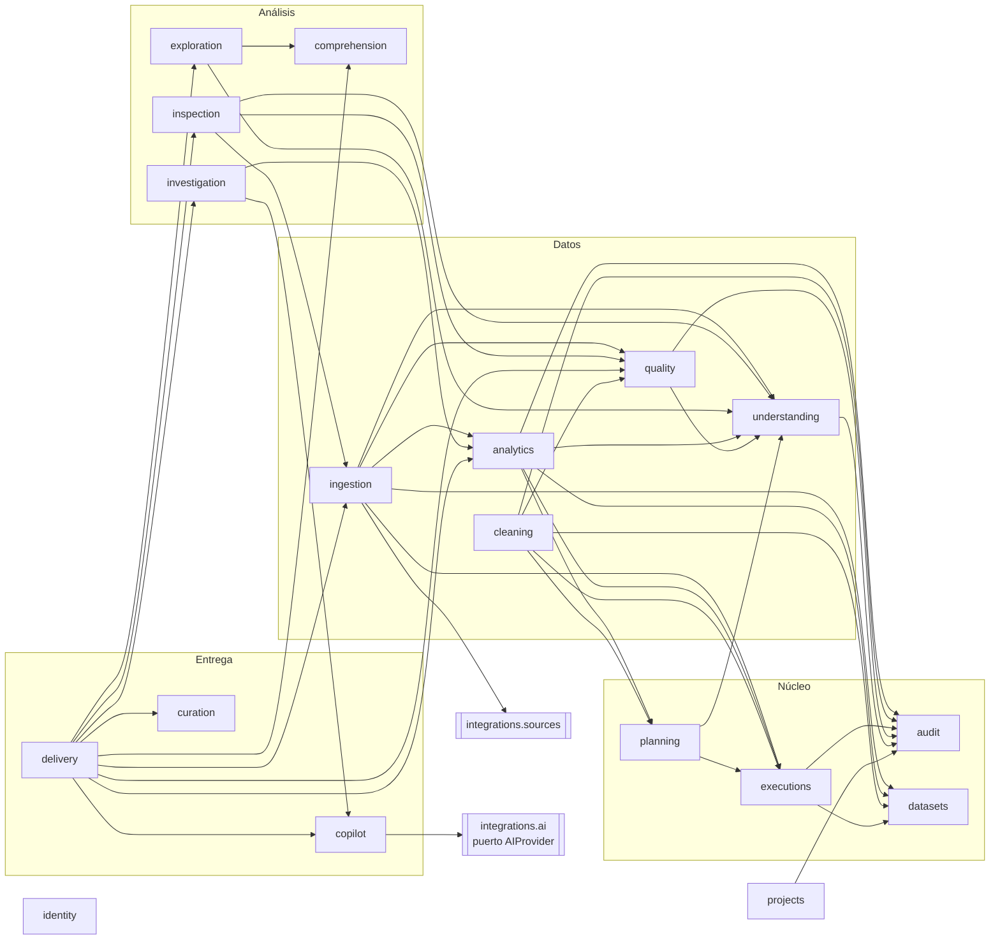
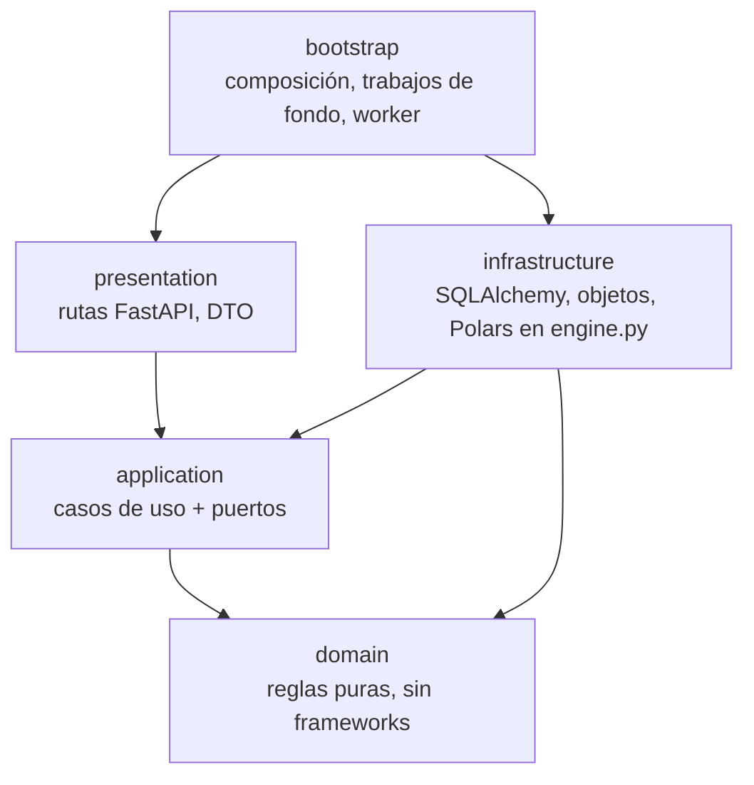
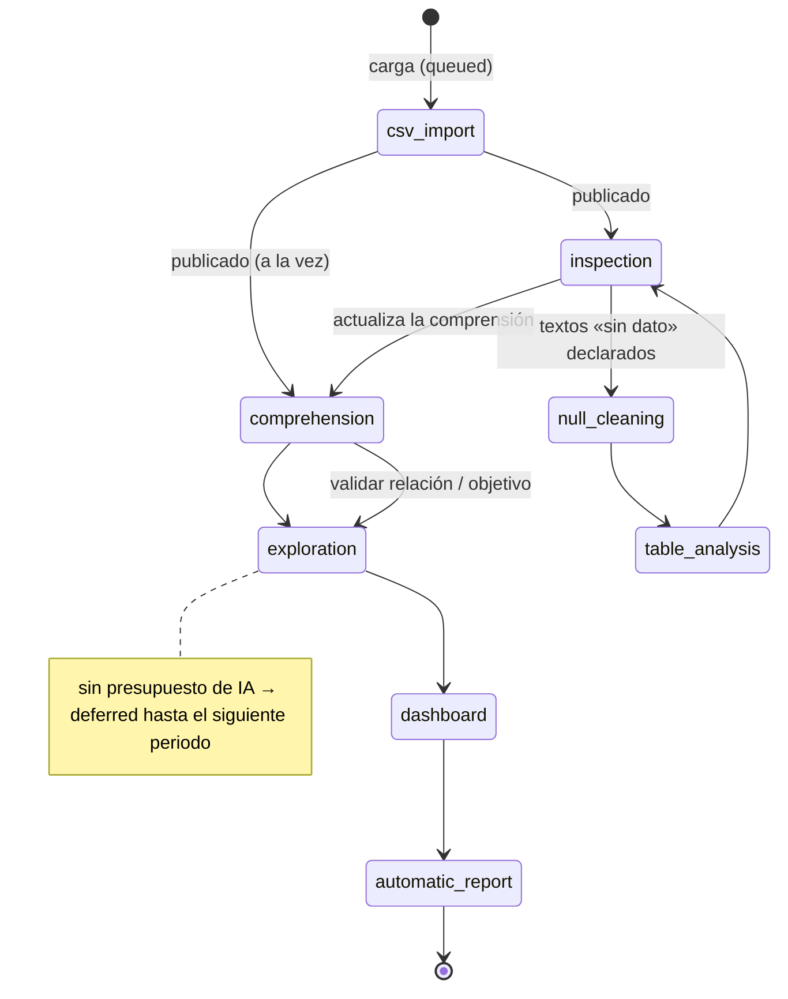

# Anexo A — Diagrama de arquitectura completo

Los diagramas están en Mermaid: GitHub y la mayoría de editores Markdown los dibujan como SVG vectorial, y
se pueden exportar en alta resolución con `npx @mermaid-js/mermaid-cli -i A-arquitectura.md -o A.svg`.

## A.1 Despliegue (producción, ADR-052)

```mermaid
flowchart TB
    subgraph Internet
      U([Navegador])
      GH[GitHub Actions<br/>build + push GHCR]
      AN[[Anthropic API]]
      XDB[(Bases del usuario<br/>PostgreSQL / SQL Server)]
    end
    subgraph VPS["VPS Ubuntu 24.04 · Docker Compose"]
      subgraph edge["red edge"]
        CADDY[caddy 2.10<br/>:80 :443 · HTTPS · HSTS]
        WEB[web · Next.js 16<br/>proxy /api/v1]
      end
      subgraph backend["red backend 172.31.251.0/24"]
        API[api · FastAPI + uvicorn<br/>1536 MB · migraciones al arrancar]
        WK[worker · mismo código<br/>1 GB · 2 CPU]
        PG[(postgres 17<br/>postgres_data)]
        OBJ[(objects_data<br/>originales · Parquet · artefactos)]
      end
      subgraph connectorNet["red connector (interna) + egress filtrada"]
        CON[connector<br/>read_only · cap_drop ALL]
      end
      SYS[systemd: backup diario 03:30 UTC ·<br/>cortafuegos de salida egress-firewall.sh]
    end
    U --> CADDY --> WEB --> API
    API <--> PG
    WK <--> PG
    API <--> OBJ
    WK <--> OBJ
    WK --> AN
    API --> CON --> XDB
    GH -. deploy.sh por SSH .-> VPS
```

## A.2 Módulos del backend y dependencias

Aristas calculadas a partir de las importaciones reales del código (`apps/api/src/dataflow/modules`); las
importaciones entre módulos sólo usan `public` o `contracts` y el grafo es acíclico
(`tests/test_architecture.py`). `bootstrap/` (composición) une los módulos con los puertos y no aparece
como dependencia.



## A.3 Capas dentro de cada módulo



Reglas verificadas por AST: domain y application no importan FastAPI, SQLAlchemy, Polars, Argon2 ni
`bootstrap`; `executions` sólo recibe puertos; `planning` no importa Polars; el cómputo de `cleaning` y
`analytics` no toca la base de datos; sólo `anthropic_provider.py` importa el SDK de IA; los lectores de
fuentes sólo se importan desde el subproceso de ingesta (y `psycopg` sólo dentro de `connect()`).

## A.4 Trabajos de fondo encadenados


